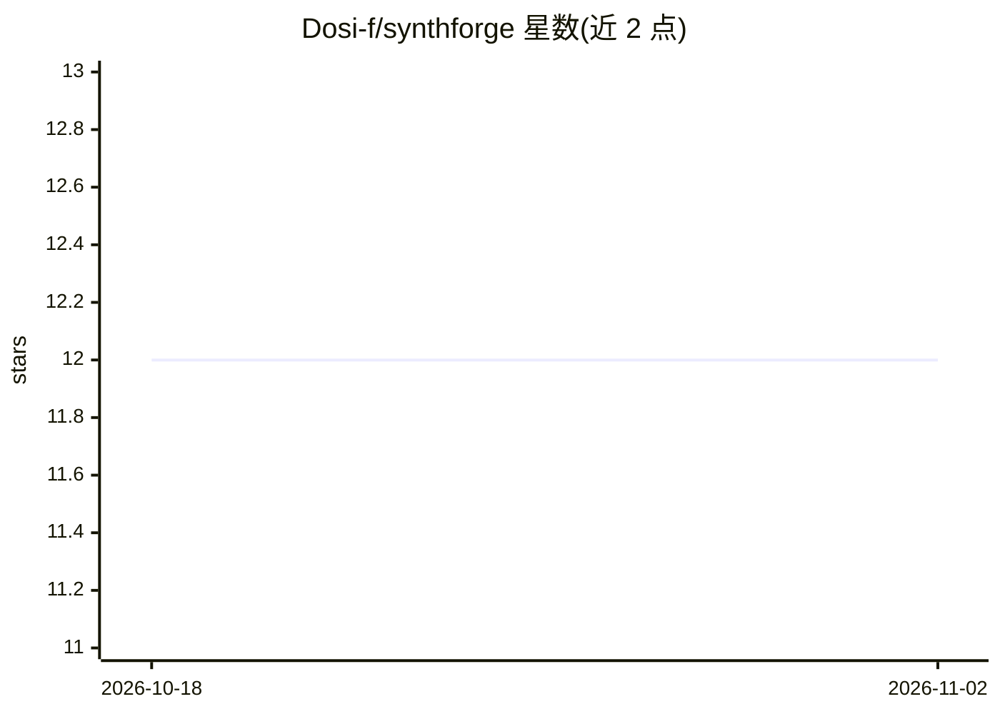

# Dosi-f/synthforge

⭐ 12 · Python · NOASSERTION · 推送 2026-06-23 · [GitHub](https://github.com/Dosi-f/synthforge) · 个人维护

**为 LLM 微调生成合成数据集的工具包**

SynthForge 是一个用于生成 LLM 微调用合成数据集的 Python 工具包，自述为早期实验性项目，特性包括多后端、可过滤与 GPU 加速。可见 README 仅含更新日志与故障排查段落：提及批处理性能改进、错误信息改进，以及遇 OOM 时减小批大小或启用梯度检查点的建议。未展示安装命令或详细用法，具体后端与过滤机制需查阅仓库其他文档确认。

## 筛选速览

| 维度 | 判定 | 备注 |
|---|---|---|
| AI 角色 | `ai-ecosystem` | LLM/agent 周边工具 |
| 许可风险 | `none` | NOASSERTION |
| 部署形态 | `None` |  |
| 模型依赖 | — | README 未给出锁定关系 |
| 硬件要求 | — | 无带数字的原话,不猜 |
| 安装摩擦 | `low` | 无编译、无系统依赖或容器化 |
| 成熟度 | — | 结构信号不足 |

## 能力要点

- 生成用于 LLM 微调的合成数据集
- 支持多后端与可过滤配置
- GPU 加速与批处理
- 自述为早期实验性项目

## 适用场景

- 为模型微调准备合成训练数据
- 按过滤条件批量生成数据

## 场景标签

 · 领域:LLM 数据工程

## 星数曲线

2026-10-18 12 → 2026-11-02 12（+0）

---
*卡片 v1 · prompt 1.4 · 生成 2026-11-01 · 置信度 low · 依据 README sha `6544e76a62c9` · [字段定义](../../DATASET.md)*
