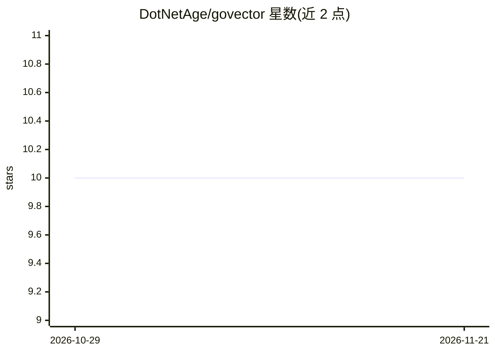

# DotNetAge/govector

⭐ 10 · Go · MIT · 推送 2026-08-11 · [GitHub](https://github.com/DotNetAge/govector) · 个人维护 · 中文 README

**Go 开发者的嵌入式向量数据库：本地存储与向量检索**

纯 Go 编写的嵌入式向量搜索引擎，提供 Qdrant 兼容的 REST API、HNSW 近似最近邻索引，数据经 BoltDB 持久化到本地文件。支持嵌入库（导入 Go 应用零网络开销）与独立服务/CLI 两种模式，内置 TUI 交互界面、载荷过滤与 SQ8 标量量化。CGO-free 可交叉编译至多平台。README 提及单机基准：100K 向量 HNSW 平均延迟 0.08 ms。

## 筛选速览

| 维度 | 判定 | 备注 |
|---|---|---|
| AI 角色 | `ai-ecosystem` | LLM/agent 周边工具 |
| 许可风险 | `permissive` | MIT |
| 部署形态 | `None` |  |
| 模型依赖 | — | README 未给出锁定关系 |
| 硬件要求 | — | 无带数字的原话,不猜 |
| 安装摩擦 | `low` | 无编译、无系统依赖或容器化 |
| 成熟度 | — | 结构信号不足 |

## 能力要点

- 嵌入式库/独立服务/CLI 三种使用模式
- Qdrant 兼容的 REST API（/collections、/points、/search）
- HNSW 索引默认启用，支持 Cosine/Euclidean/Dot Product 距离
- 纯 Go、CGO-free，支持 SQ8 量化降低磁盘占用

## 适用场景

- 为 Go 桌面或后端应用嵌入本地向量检索
- 本地/边缘场景替代运行分布式向量集群
- 通过 CLI 与 TUI 管理向量集合数据

## 场景标签

`向量数据库` · 领域:知识与检索

## 证据(README 行号)

> L15: **GoVector** is a high-performance, embedded vector search engine written entirely in Go. It offers **Qdrant-compat
> L33: - 🔌 **Dual Modes**:
> L35:  - **Standalone Server / CLI**: Run it as a lightweight microservice with a Qdrant-compatible REST API, or manage d
> L112: GoVector supports the standard Qdrant-like REST API for `/collections`, `/points`, and `/search`.

## 星数曲线

2026-10-29 10 → 2026-11-21 10（+0）

---
*卡片 v1 · prompt 1.4 · 生成 2026-11-20 · 置信度 high · 依据 README sha `dc681a8dc0be` · [字段定义](../../DATASET.md)*
