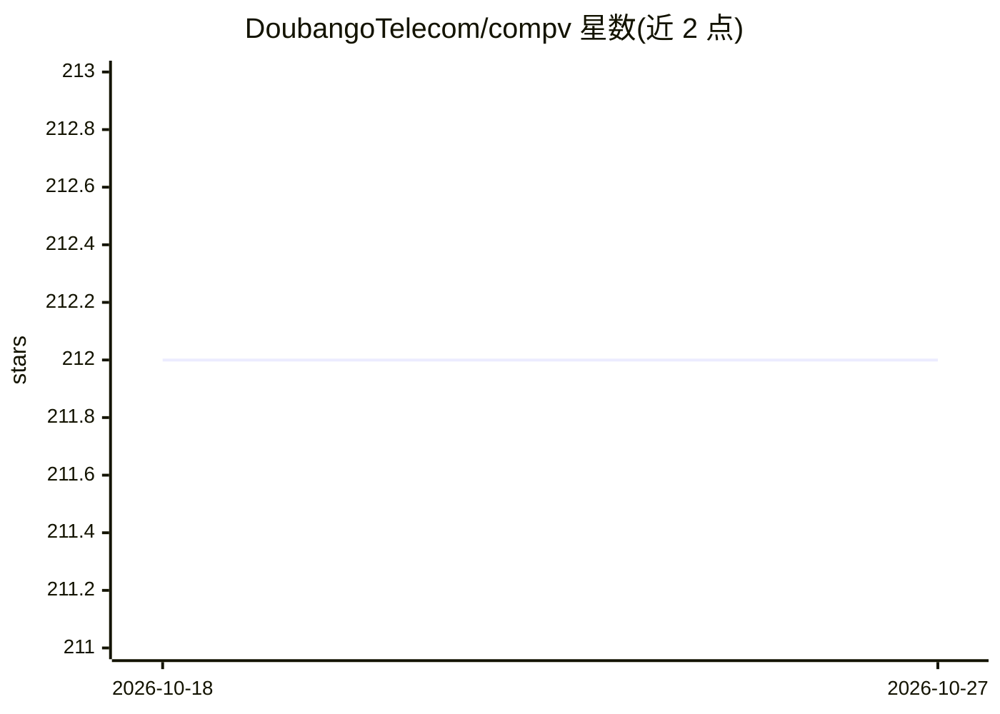

# DoubangoTelecom/compv

⭐ 212 · C++ · GPL-3.0 · 推送 2026-09-20 · [GitHub](https://github.com/DoubangoTelecom/compv) · [官网](https://doubango.org) · 组织维护

**面向 ARM/x86 的高性能计算机视觉库（Doubango R&D 项目）**

Doubango Telecom 的研究与开发计算机视觉库，面向 ARM 与 x86 设备，通过手写汇编（约占代码 10%）、SSE/AVX/NEON SIMD、CUDA/OpenVINO/OpenCL/OpenGL/NNAPI/Metal 的 GPGPU、多线程与定点数学等手段进行性能优化，README 中附有与 OpenCV 的速度对比文件。该库支撑其一系列商业 SDK 与在线演示应用（KYC 证件识别、人脸识别与 3D 活体检测、ANPR/ALPR、MRZ/MRP、银行卡/支票 OCR、MICR、CBIR、场景文字识别）。README 明确声明目前无文档，且不面向其他公司使用；未给出安装或构建说明。

## 筛选速览

| 维度 | 判定 | 备注 |
|---|---|---|
| AI 角色 | `ai-native` | 本体是模型或模型工具 |
| 许可风险 | `viral` | GPL-3.0 |
| 部署形态 | `None` |  |
| 模型依赖 | — | README 未给出锁定关系 |
| 硬件要求 | — | 无带数字的原话,不猜 |
| 安装摩擦 | `medium` | 含编译或系统依赖之一 |
| 成熟度 | `idea` | |

## 能力要点

- 手写汇编与 SSE/AVX/NEON SIMD 优化
- 支持 CUDA、OpenVINO、OpenCL、OpenGL、NNAPI、Metal 的 GPGPU 加速
- 支撑 KYC/人脸/ANPR/MRZ/银行卡 OCR 等 SDK 与云端演示应用

## 适用场景

- 在 ARM/x86 嵌入式或桌面设备上做证件、车牌、银行卡等识别开发
- 参考高性能 CV 优化技术（SIMD/GPGPU/多线程）

## 场景标签

`OCR` `人脸识别` · 领域:感知与多模态

## 证据(README 行号)

> L1: This is our R&D Computer Vision project. For now there is no documentation and it's not intended to be used by other
> L16: ### SDKs using our code ###

## 星数曲线

2026-10-18 212 → 2026-10-27 212（+0）

---
*卡片 v1 · prompt 1.4 · 生成 2026-10-22 · 置信度 mid · 依据 README sha `ca9c7d4be83b` · [字段定义](../../DATASET.md)*
