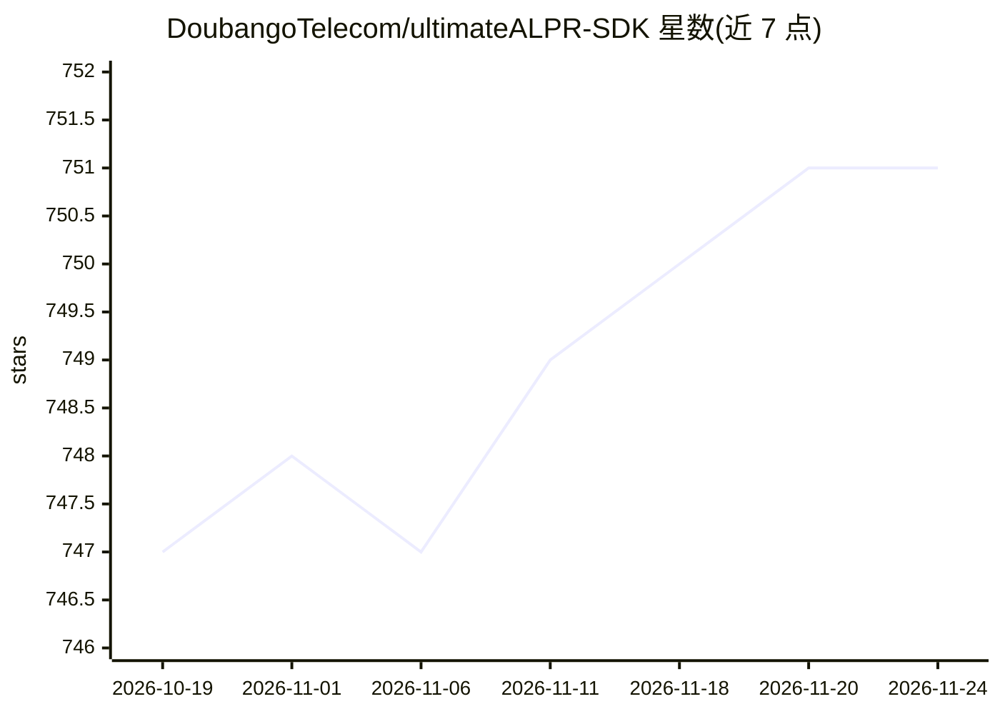

# DoubangoTelecom/ultimateALPR-SDK

⭐ 751 · C++ · NOASSERTION · 推送 2026-11-15 · [GitHub](https://github.com/DoubangoTelecom/ultimateALPR-SDK) · [官网](https://www.doubango.org/webapps/alpr/) · 组织维护

**离线车牌识别（ANPR/ALPR）SDK，覆盖多芯片多系统**

UltimateALPR 是一个面向嵌入式设备与服务器的车牌识别 SDK，可离线运行，无需注册、许可密钥或联网。核心机制是量化模型（QUINT8）配合多后端深度学习框架（TensorFlow Lite、OpenVINO、TensorRT、Hailo、RKNPU2、ONNX Runtime），针对 ARM64、x86_64 与多种 GPU/NPU 优化。除车牌识别外还提供夜间图像增强、车牌国家识别、车辆颜色/品牌型号/车身样式识别、方向追踪与车速估计。提供 C++、C#、Java、Python API 与预构建示例。

## 筛选速览

| 维度 | 判定 | 备注 |
|---|---|---|
| AI 角色 | `ai-native` | 本体是模型或模型工具 |
| 许可风险 | `none` | NOASSERTION |
| 部署形态 | `None` |  |
| 模型依赖 | local-ok | 支持本地模型 |
| 硬件要求 | — | 无带数字的原话,不猜 |
| 安装摩擦 | `medium` | 含编译或系统依赖之一 |
| 成熟度 | — | 结构信号不足 |

## 能力要点

- 多框架后端：TensorFlow Lite、OpenVINO、TensorRT、Hailo、RKNPU2、ONNX Runtime
- 多字符集支持：Latin、Korean、Chinese
- 量化模型（QUINT8）低内存占用，离线运行不上传数据
- 附带 IENV、LPCI、VCR、VMMR、VBSR、VDT、VSE 等扩展识别能力

## 适用场景

- 在嵌入式摄像头/边缘设备上离线识别车牌
- 在 Jetson、树莓派等 ARM64 设备上做实时车牌识别
- 需要车牌国家、车辆颜色、车型等扩展信息识别的项目

## 场景标签

`目标检测` `图像视频处理` · 领域:感知与多模态

## 证据(README 行号)

> L17: **UltimateALPR** is a highly optimized ANPR / ALPR (Automatic Number/License Plate Recognition) SDK designed to run
> L35: In addition to License Plate Recognition (LPR) we support Image Enhancement for Night-Vision (IENV), License Plate 

## 星数曲线

2026-10-19 747 → 2026-11-24 751（+4）

---
*卡片 v1 · prompt 1.4 · 生成 2026-11-24 · 置信度 high · 依据 README sha `22126b38cbbb` · [字段定义](../../DATASET.md)*
