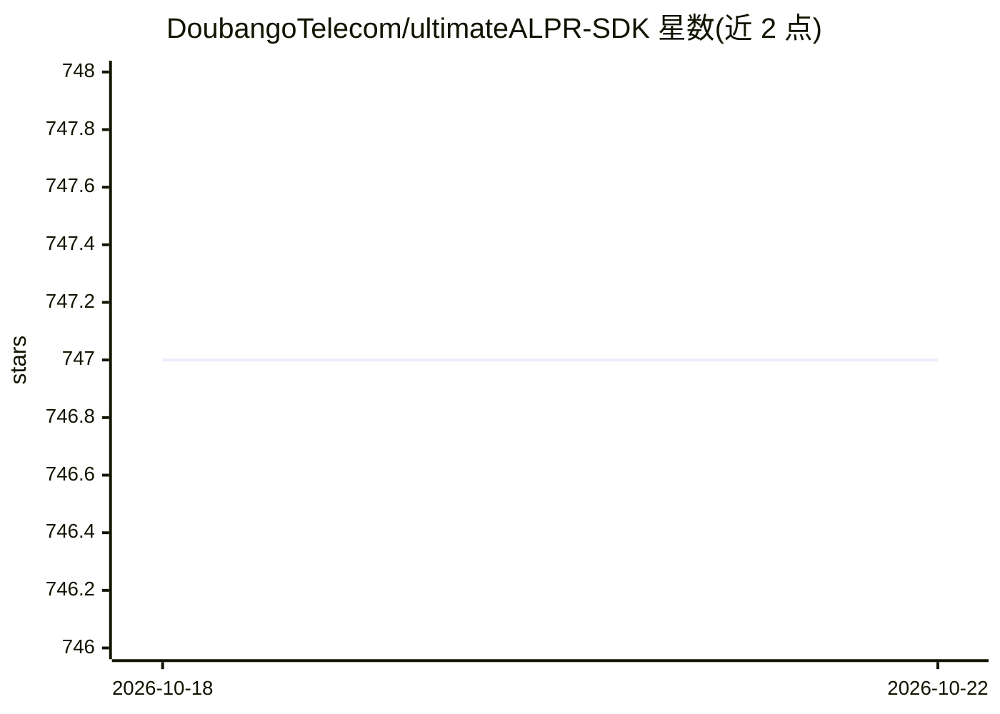

# DoubangoTelecom/ultimateALPR-SDK

⭐ 747 · C++ · NOASSERTION · 推送 2025-11-05 · [GitHub](https://github.com/DoubangoTelecom/ultimateALPR-SDK) · [官网](https://www.doubango.org/webapps/alpr/) · 组织维护

**给开发者的深度学习车牌识别（ANPR/ALPR）SDK，跨平台多语言 API**

基于深度学习的车牌识别引擎 SDK，提供 LPR、车牌国家识别、车辆颜色/厂商/车身样式识别、方向跟踪与车速估计等功能。支持 CPU（SIMD ARM NEON）、GPU、VPU、FPGA 加速（CUDA、TensorRT、OpenVINO），可在 Android、Raspberry Pi、Linux、Jetson、Windows 等设备端运行，无需注册、许可密钥或联网。API 覆盖 C++、C#、Java、Python，附带 Android 与 C++ 示例应用（Benchmark、Recognizer 等）及在线 web demo。README 未给出 Python pip 等包管理器安装命令，Android 侧以源码/模块方式集成。

## 筛选速览

| 维度 | 判定 | 备注 |
|---|---|---|
| AI 角色 | `ai-native` | 本体是模型或模型工具 |
| 许可风险 | `none` | NOASSERTION |
| 部署形态 | `None` |  |
| 模型依赖 | — | README 未给出锁定关系 |
| 硬件要求 | — | 无带数字的原话,不猜 |
| 安装摩擦 | `medium` | 含编译或系统依赖之一 |
| 成熟度 | — | 结构信号不足 |

## 能力要点

- 车牌识别及 LPCI/VCR/VMMR/VBSR/VDT/VSE 多项车辆分析功能
- CPU/GPU/VPU/FPGA 加速（CUDA、TensorRT、OpenVINO），设备端离线运行
- C++/C#/Java/Python 四语言 API，Android/Raspberry Pi/Linux/Jetson/Windows 多平台支持
- 自带 Benchmark、Recognizer 等示例应用，无需注册或许可密钥

## 适用场景

- 在嵌入式设备（Jetson、Khadas、树莓派）上构建实时车牌识别应用
- 通过 C++/C#/Java/Python API 将车牌与车辆属性识别集成到自有产品
- 在无网络环境下进行设备端车辆识别，数据不出本机

## 场景标签

`目标检测` · 领域:感知与多模态

## 证据(README 行号)

> L25: Have you ever seen a deep learning based ANPR/ALPR (Automatic Number/License Plate Recognition) engine running at *
> L43: In addition to License Plate Recognition (LPR) we support Image Enhancement for Night-Vision (IENV), License Plate 

## 星数曲线

2026-10-18 747 → 2026-10-22 747（+0）

---
*卡片 v1 · prompt 1.4 · 生成 2026-10-21 · 置信度 high · 依据 README sha `873dab7adf21` · [字段定义](../../DATASET.md)*
