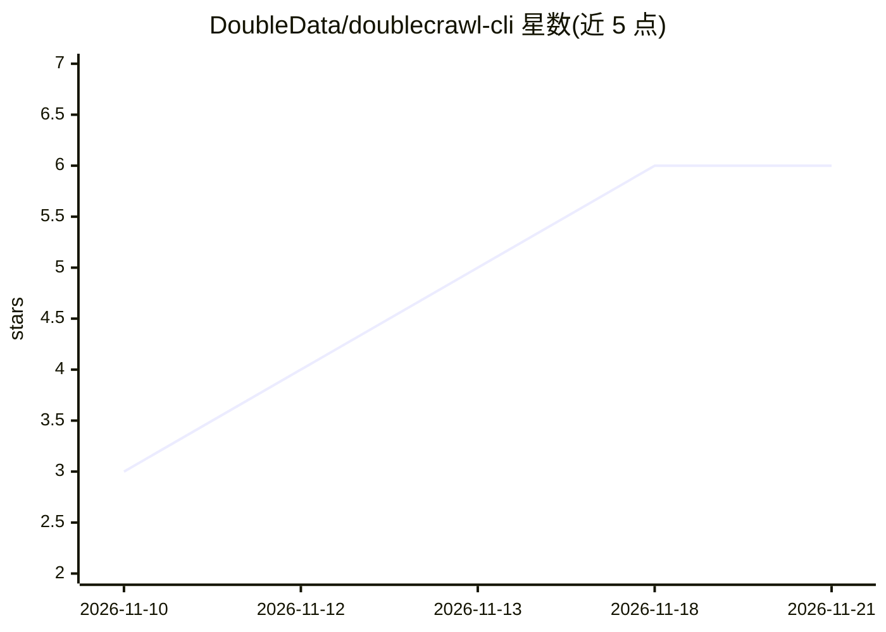

# DoubleData/doublecrawl-cli

⭐ 6 · 推送 2026-11-20 · [GitHub](https://github.com/DoubleData/doublecrawl-cli) · [官网](https://doublecrawl.com) · 组织维护

**给终端脚本和 AI agent 提供网页抓取的命令行工具**

Go 编写的单文件静态二进制 CLI：发送 URL 经 DoubleCrawl 服务端路由抓取目标页面，页面内容输出到 stdout，可像 curl 一样管道和重定向。按到达的页面计费，失败尝试与超时不计费；支持指定出口国家、--json 结构化输出、文档化退出码、API key 管理、用量与请求日志查询。支持浏览器 OAuth 登录并将终端注册为 agent，提供托管 MCP 服务器与 Claude Code 插件，凭据存于 OS keychain。需注册账号并使用其云端服务。

## 筛选速览

| 维度 | 判定 | 备注 |
|---|---|---|
| AI 角色 | `ai-ecosystem` | LLM/agent 周边工具 |
| 许可风险 | `none` | — |
| 部署形态 | `desktop` | 安装包/桌面程序 |
| 模型依赖 | — | README 未给出锁定关系 |
| 硬件要求 | — | 无带数字的原话,不猜 |
| 安装摩擦 | `low` | 无编译、无系统依赖或容器化 |
| 成熟度 | — | 结构信号不足 |

## 能力要点

- 单静态二进制，无运行时依赖，凭据存 OS keychain，Sigstore 签名与 SBOM
- 失败/超时页面不计费，只有送达或确认缺失才扣 credits
- 每个命令支持 --json 与文档化退出码，适配脚本与 agent 调用
- 提供托管 MCP 服务器（fetch_page/get_balance 等工具）与 Claude Code 插件安装路径

## 适用场景

- 脚本或 CI 中批量抓取内置 fetch 打不开的页面
- 让 Claude Code/Cursor 等 agent 通过 MCP 调用抓取网页
- 需要指定出口国家抓取公开页面时按量付费使用

## 场景标签

`网页抓取` · 领域:效率与自动化

## 证据(README 行号)

> L27: - **Built for agents.** Every command speaks `--json`, exit codes are documented, and the same account works
> L253: **Agents that speak MCP** can use the hosted server at `https://mcp.doublecrawl.com/mcp` (OAuth sign-in, no key
> L130:       --country string       exit country: us, de, gb, es, pl or jp

## 星数曲线

2026-11-10 3 → 2026-11-21 6（+3）

---
*卡片 v1 · prompt 1.4 · 生成 2026-11-20 · 置信度 high · 依据 README sha `134d5c126a69` · [字段定义](../../DATASET.md)*
