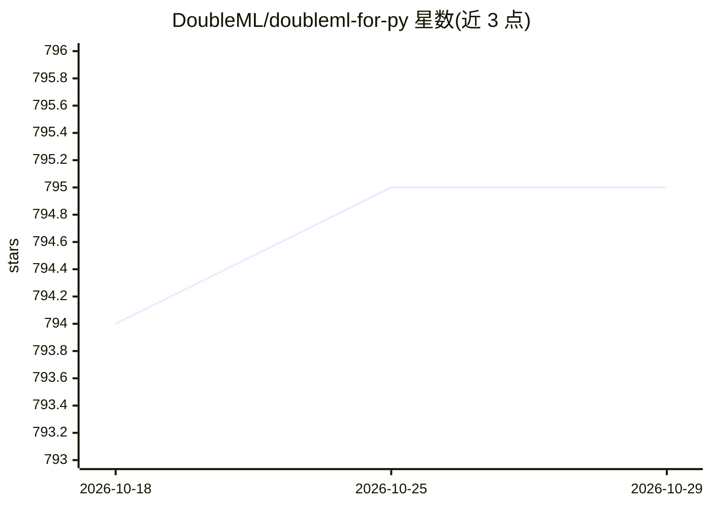

# DoubleML/doubleml-for-py

⭐ 795 · Python · BSD-3-Clause · 推送 2026-10-28 · [GitHub](https://github.com/DoubleML/doubleml-for-py) · [官网](https://docs.doubleml.org) · 组织维护

**Python 双重/去偏机器学习因果推断库：估计处理效应并做统计推断**

实现 Chernozhukov 等 (2018) 双重/去偏机器学习框架的 Python 包，基于 scikit-learn 构建，面向经济学与数据科学中的因果推断。支持部分线性回归 (PLR)、部分线性 IV 回归 (PLIV)、交互回归 (IRM)、交互 IV 回归 (IIVM) 四类模型的处理效应估计与统计推断（fit/bootstrap/confint/p_adjust/tune）。采用面向对象设计，干扰函数的机器学习器、重采样方案、得分函数均可替换，并可扩展新模型类。有配套 R 孪生包（基于 mlr3）。

## 筛选速览

| 维度 | 判定 | 备注 |
|---|---|---|
| AI 角色 | `ai-native` | 本体是模型或模型工具 |
| 许可风险 | `permissive` | BSD-3-Clause |
| 部署形态 | `library` | 以包/库形式分发 |
| 模型依赖 | — | README 未给出锁定关系 |
| 硬件要求 | — | 无带数字的原话,不猜 |
| 安装摩擦 | `low` | 无编译、无系统依赖或容器化 |
| 成熟度 | — | 结构信号不足 |

## 能力要点

- 四类模型（PLR/PLIV/IRM/IIVM）的处理效应估计与统计推断
- 干扰函数估计器、重采样方案、得分函数均可灵活替换
- 面向对象实现，可扩展新模型类与自定义得分
- 配套 R 孪生包（基于 mlr3）

## 适用场景

- 用机器学习方法估计因果处理效应并做假设检验
- 工具变量场景下估计结构参数
- 对估计结果做 bootstrap 置信区间与多重检验校正

## 场景标签

 · 领域:因果推断/计量经济学

## 证据(README 行号)

> L10: The Python package **DoubleML** provides an implementation of the double / debiased machine learning framework of
> L29: Double / debiased machine learning (Chernozhukov et al. (2018)) for
> L31: - Partially linear regression models (PLR)

## 星数曲线

2026-10-18 794 → 2026-10-29 795（+1）

---
*卡片 v1 · prompt 1.4 · 生成 2026-10-21 · 置信度 high · 依据 README sha `730b144eaf05` · [字段定义](../../DATASET.md)*
