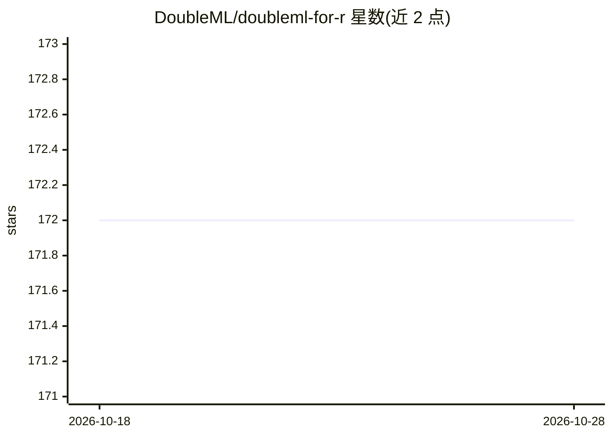

# DoubleML/doubleml-for-r

⭐ 172 · R · NOASSERTION · 推送 2026-10-27 · [GitHub](https://github.com/DoubleML/doubleml-for-r) · [官网](https://docs.doubleml.org) · 组织维护

**R 语言双重机器学习因果推断包，供研究者估计处理效应**

实现 Chernozhukov et al. (2018) 双重/去偏机器学习框架的 R 包，基于 mlr3 生态构建，以 R6 面向对象方式提供 PLR、PLIV、IRM、IIVM 四类模型类，通过机器学习方法估计 nuisance 函数并计算 Neyman 正交得分。提供 fit、bootstrap、confint、p_adjust、tune 等方法做估计与统计推断，支持自定义 ML 方法、重采样方案与得分函数扩展。与基于 scikit-learn 的 Python 孪生包同步开发。安装需 R >= 3.5 及 mlr3 系列依赖。

## 筛选速览

| 维度 | 判定 | 备注 |
|---|---|---|
| AI 角色 | `ai-native` | 本体是模型或模型工具 |
| 许可风险 | `none` | NOASSERTION |
| 部署形态 | `library` | 以包/库形式分发 |
| 模型依赖 | — | README 未给出锁定关系 |
| 硬件要求 | — | 无带数字的原话,不猜 |
| 安装摩擦 | `low` | 无编译、无系统依赖或容器化 |
| 成熟度 | — | 结构信号不足 |

## 能力要点

- 四类部分线性/交互模型（PLR/PLIV/IRM/IIVM）的因果参数估计
- 基于 mlr3 的灵活 nuisance 函数机器学习估计
- fit/bootstrap/confint/p_adjust/tune 完整统计推断方法
- 支持扩展新模型类、自定义得分函数与重采样方案

## 适用场景

- 经济学与流行病学中估计处理效应与结构参数
- 高维控制变量下做因果推断与假设检验
- 通过调参方法选择 nuisance 学习器并复现实验

## 场景标签

`科研工具` · 领域:学习与行业

## 证据(README 行号)

> L9: The R package **DoubleML** provides an implementation of the double /
> L35: Double / debiased machine learning framework of [Chernozhukov et
> L46: implement the estimation of the nuisance functions via machine learning

## 星数曲线

2026-10-18 172 → 2026-10-28 172（+0）

---
*卡片 v1 · prompt 1.4 · 生成 2026-10-22 · 置信度 mid · 依据 README sha `34fb75115d27` · [字段定义](../../DATASET.md)*
