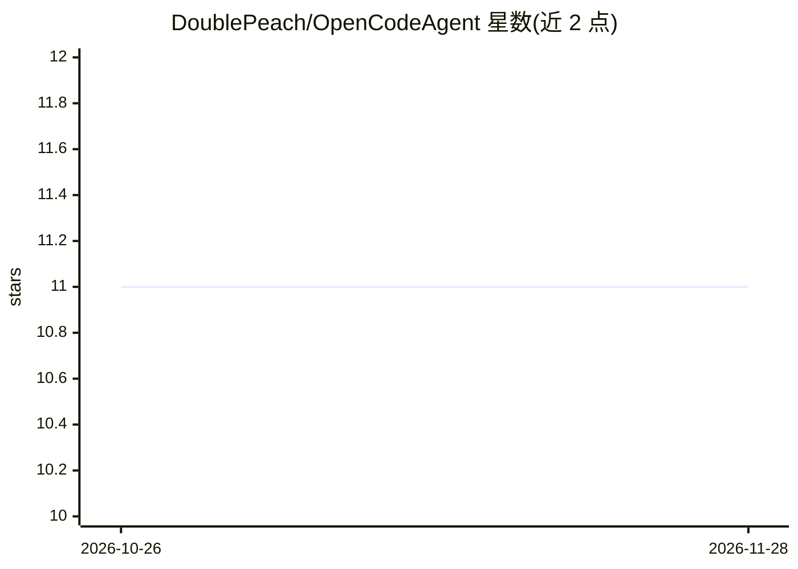

# DoublePeach/OpenCodeAgent

⭐ 11 · TypeScript · 推送 2026-04-03 · [GitHub](https://github.com/DoublePeach/OpenCodeAgent) · 组织维护 · 中文 README

**开源终端 AI 编程助手 CLI，可接多厂商模型与本地部署**

基于 Claude Code CLI 社区还原版二次开发的终端编程 Agent：提供交互式 REPL、文件读写编辑、ripgrep 代码搜索、Shell 执行、子 Agent 并行、MCP 工具扩展、三级权限模式与任务追踪。通过 /provider 命令在 Anthropic、DeepSeek、阿里百炼、火山引擎、Ollama 及任意 OpenAI 兼容端点间切换，配置落盘 ~/.oca。要求 Bun >= 1.2.0，以 git clone 加 bun install 方式从源码运行。声明与 Anthropic 无官方关联，许可证待法律确认后发布。

## 筛选速览

| 维度 | 判定 | 备注 |
|---|---|---|
| AI 角色 | `ai-native` | 本体是模型或模型工具 |
| 许可风险 | `none` | — |
| 部署形态 | `None` |  |
| 模型依赖 | local-ok | 支持本地模型 |
| 硬件要求 | — | 无带数字的原话,不猜 |
| 安装摩擦 | `low` | 无编译、无系统依赖或容器化 |
| 成熟度 | `idea` | |

## 能力要点

- /provider 命令随时切换厂商与模型，配置持久化到 ~/.oca
- 支持 Anthropic 原生及 OpenAI 兼容接口（DeepSeek/百炼/火山引擎/Ollama）
- 50+ 内置工具、MCP 协议接入、多 Agent 协作
- 界面与向导支持中英双语切换（/language）

## 适用场景

- 在终端里让 AI 读仓库、改代码、跑命令完成开发任务
- 通过 Ollama 在内网或离线环境本地运行编程 Agent
- 在不同云厂商 API 与本地模型之间组合切换开发工作流

## 场景标签

`编码 Agent` · 领域:编码与开发

## 证据(README 行号)

> L19: 基于3月31日的CC事件而诞生的项目，完整修复版本、去除繁杂的原厂限制、支持本地私有化部署、支持多模型适配、例如阿里百炼、火山引擎、OpenAI、DeepSeek等，还支持本地Ollama接入。甚至还加了中文适配，国人也可以简单上
> L21: OpenCodeAgent 是面向全球开发者魔改并持续演进的 **开源终端 AI 编程助手**：同一套交互与工具链，换模型不换肌肉记忆——本地、国内 API、海外 API，随你组合。

## 星数曲线

2026-10-26 11 → 2026-11-28 11（+0）

---
*卡片 v1 · prompt 1.4 · 生成 2026-11-19 · 置信度 high · 依据 README sha `d9f74a22d73d` · [字段定义](../../DATASET.md)*
