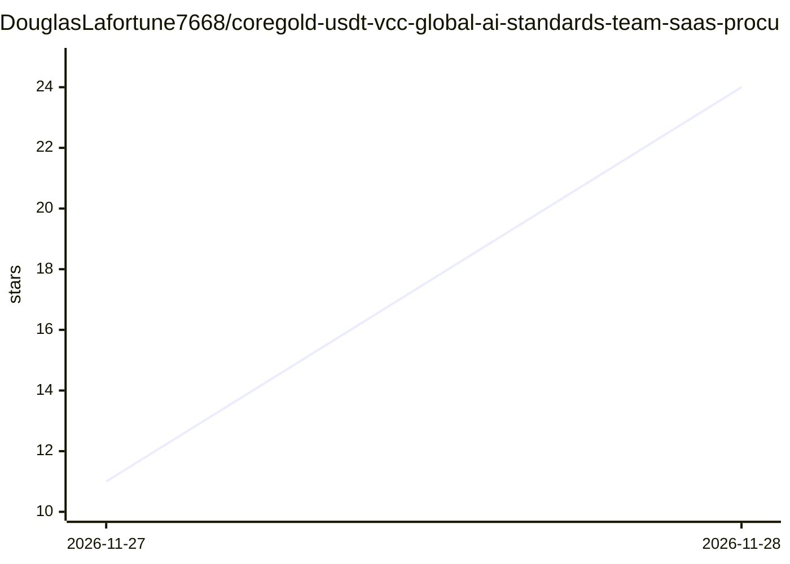

# DouglasLafortune7668/coregold-usdt-vcc-global-ai-standards-team-saas-procurement-guide

⭐ 24 · 推送 2026-11-26 · [GitHub](https://github.com/DouglasLafortune7668/coregold-usdt-vcc-global-ai-standards-team-saas-procurement-guide) · [官网](https://app.coregold.io/signup?invite_code=ADvlj9b) · 组织维护 · 中文 README

**面向跨境团队的核心金虚拟卡全球SaaS采购指南**

描述如何使用 CoreGold 集中管理团队订阅和云服务的文档：使用 USDT (TRC20) 充值钱包，申请个人或团队计划下的美国发行的虚拟卡，按部门/用途划分卡片，保持 AVS 账单地址一致，并将卡片绑定到 Apple Pay / Google Pay。包含 4 步治理流程和分步设置教程。无软件安装；平台通过核心金网站注册。与 AI 的联系仅限于在讨论 SaaS/云计费治理时，引用全球 AI 标准化报告作为背景。

## 筛选速览

| 维度 | 判定 | 备注 |
|---|---|---|
| AI 角色 | `ai-knowledge` | 知识聚合/清单类 |
| 许可风险 | `none` | — |
| 部署形态 | `None` |  |
| 模型依赖 | — | README 未给出锁定关系 |
| 硬件要求 | — | 无带数字的原话,不猜 |
| 安装摩擦 | `low` | 无编译、无系统依赖或容器化 |
| 成熟度 | — | 结构信号不足 |

## 能力要点

- 由 USDT (TRC20) 存款资助的美国发行虚拟卡
- 带多卡管理和按部门划分的团队计划
- 绑定 Apple Pay / Google Pay 及验证码流程
- 开箱/项目关闭时的卡片冻结和余额提取

## 适用场景

- 为跨境团队统一支付海外 SaaS 订阅与云费用
- 按部门或产品线拆分虚拟卡管理预算
- 为外包人员发放并在离场时冻结专用卡片

## 场景标签

 · 领域:支付/虚拟卡指南

## 证据(README 行号)

> L2: As global AI standardization advances—highlighted by November 2026 reports of 78 international AI standards led into
> L9: Instead of reimbursing ad-hoc personal credit card charges at month-end, **CoreGold** lets teams fund centrally with
> L30: Visit https://app.coregold.io/signup?invite_code=ADvlj9b, register using your regular email address, and log in to 

## 星数曲线

2026-11-27 11 → 2026-11-28 24（+13）

---
*卡片 v1 · prompt 1.4 · 生成 2026-11-27 · 置信度 mid · 依据 README sha `51701d5ca73b` · [字段定义](../../DATASET.md)*
