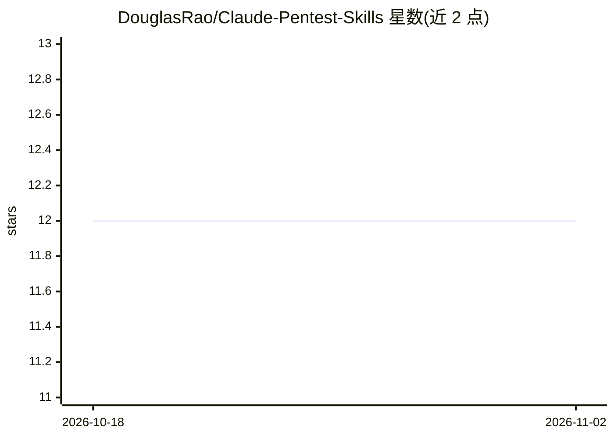

# DouglasRao/Claude-Pentest-Skills

⭐ 12 · Shell · MIT · 推送 2026-04-05 · [GitHub](https://github.com/DouglasRao/Claude-Pentest-Skills) · 个人维护

**面向 Claude Code 的渗透测试技能包：AD 与 Web 攻防结构化工作流**

以 Claude Code skills（Markdown 文件 + Bash 脚本）形式提供的渗透测试技能集合，覆盖两条独立链路：AD 轨道（侦察、凭据攻击与域控、后渗透、报告）与 Web 轨道（侦察、OWASP Top 10 漏洞利用、后渗透、报告）。各技能读取前一阶段输出避免重复枚举，支持检查点续跑、并行任务、工具缺失时降级跳过，并可通过 Burp/Postman/Notion MCP 集成取证与发布报告。跨 macOS 与 Kali Linux，需依赖 nmap、impacket 等外部工具。

## 筛选速览

| 维度 | 判定 | 备注 |
|---|---|---|
| AI 角色 | `ai-ecosystem` | LLM/agent 周边工具 |
| 许可风险 | `permissive` | MIT |
| 部署形态 | `library` | 以包/库形式分发 |
| 模型依赖 | locked-api |  |
| 硬件要求 | — | 无带数字的原话,不猜 |
| 安装摩擦 | `low` | 无编译、无系统依赖或容器化 |
| 成熟度 | — | 结构信号不足 |

## 能力要点

- AD 与 Web 两条独立技能链，前一阶段输出直接驱动下一阶段
- 脚本化执行、检查点续跑、PID 数组追踪的并行任务
- 工具缺失时降级跳过，不崩溃
- CVSS 3.1 评分报告生成与 Notion MCP 发布

## 适用场景

- 在 Claude Code 中执行 AD 域渗透的侦察到报告全流程
- Web 渗透测试与漏洞赏金侦察、利用及后渗透
- 自动生成带 CVSS 评分与攻击路径叙述的渗透测试报告

## 场景标签

`网络安全` · 领域:学习与行业

## 证据(README 行号)

> L7: Claude Code supports **skills** — Markdown files loaded into the LLM context that define specialized behaviors. This
> L3: Professional penetration testing skills for Claude Code. Drop-in skill packs that give Claude structured, tool-aware

## 星数曲线

2026-10-18 12 → 2026-11-02 12（+0）

---
*卡片 v1 · prompt 1.4 · 生成 2026-11-01 · 置信度 mid · 依据 README sha `83abdda5f95a` · [字段定义](../../DATASET.md)*
