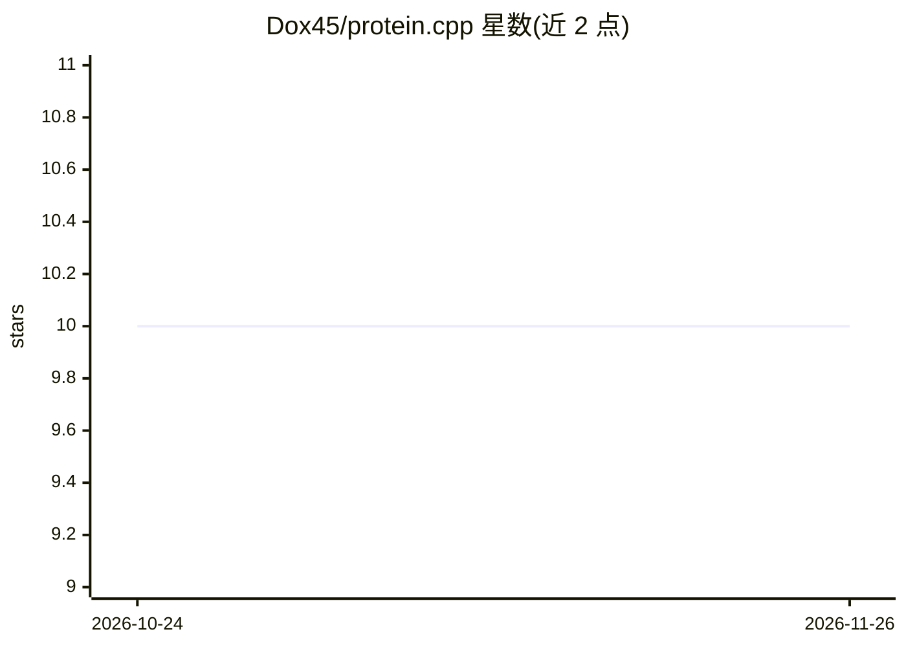

# Dox45/protein.cpp

⭐ 10 · C · 推送 2026-06-11 · [GitHub](https://github.com/Dox45/protein.cpp) · 个人维护

**ESMC 蛋白质语言模型的 C++ 本地推理引擎**

基于 GGML 构建的 ESMC 蛋白质语言模型推理引擎，在 CPU 上运行、运行时无需 Python/PyTorch。提供权重转换脚本（从 PyTorch/HuggingFace checkpoint 转为 .esmf 格式）、Q8_0/Q4_0 整数量化工具与 CLI 推理器，输出逐残基 masked LM logits，可用 X 掩码让模型预测残基。权重 mmap 加载，当前为 Beta，正确性验证针对参考 PyTorch 实现仍在进行中。

## 筛选速览

| 维度 | 判定 | 备注 |
|---|---|---|
| AI 角色 | `ai-native` | 本体是模型或模型工具 |
| 许可风险 | `permissive` | — |
| 部署形态 | `library` | 以包/库形式分发 |
| 模型依赖 | — | README 未给出锁定关系 |
| 硬件要求 | — | 无带数字的原话,不猜 |
| 安装摩擦 | `medium` | 含编译或系统依赖之一 |
| 成熟度 | `idea` | |

## 能力要点

- CPU 单二进制推理，运行时无 Python/PyTorch/LibTorch 依赖
- 内置 Q8_0 与 Q4_0 整数量化，mmap 加载权重
- 权重转换脚本支持 PyTorch/HuggingFace ESMC checkpoint
- --debug 输出 Layer-0 激活统计用于数值审计

## 适用场景

- 无 GPU 环境下本地运行 ESMC 模型做序列推理
- 将推理嵌入现有 C/C++ 或 Rust 生信流水线
- 内存受限机器上用量化权重运行较大序列

## 场景标签

`推理引擎` `模型量化` · 领域:训练与推理

## 证据(README 行号)

> L9: ESMF is a standalone C++ inference engine for the **ESMC (ESM Cambrian)** family of protein language models, built d
> L11: The goal is a small, auditable, hardware-efficient runner that produces outputs faithful to the reference PyTorch i
> L59: 3. **Masked LM head** — final representations projected through `Linear → GELU → LayerNorm → Linear` to produce per

## 星数曲线

2026-10-24 10 → 2026-11-26 10（+0）

---
*卡片 v1 · prompt 1.4 · 生成 2026-11-20 · 置信度 mid · 依据 README sha `dd45ccdda0b7` · [字段定义](../../DATASET.md)*
