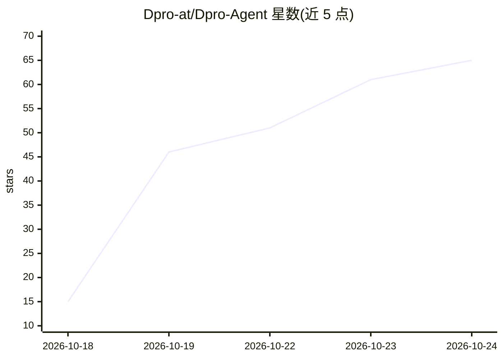

# Dpro-at/Dpro-Agent

⭐ — · [GitHub]() · 个人维护

**开源跨平台 AI 桌面助手：多 Agent 协作执行任务，支持本地/云端模型**

面向个人与团队用户的桌面 AI Agent 应用（Tauri + Next.js + Fastify + SQLite）：用户提出请求后由路由分发给具有角色、性格、长期记忆与权限的多个 Agent，在共享任务板上规划、拆分并执行任务。支持按 Agent 选择云端或本地模型，轻量任务交给本地小模型以节省付费 token；通过 Claude Code 与 Codex 复用用户已有的 Claude/ChatGPT 订阅，不额外收 API 费。另含多渠道接入（Telegram/WhatsApp 等）、行情盯盘与模拟交易（扩展）、合规审查等。GenVR 3D 世界、手机端等功能标注开发中。提供 Windows/macOS/Linux 安装包，也可从源码运行（Node.js 20+、pnpm 8+，语音功能需 Python 3.12+）。

## 筛选速览

| 维度 | 判定 | 备注 |
|---|---|---|
| AI 角色 | `ai-native` | 本体是模型或模型工具 |
| 许可风险 | `permissive` | — |
| 部署形态 | `desktop` | 安装包/桌面程序 |
| 模型依赖 | — | README 未给出锁定关系 |
| 硬件要求 | — | 无带数字的原话,不猜 |
| 安装摩擦 | `low` | 无编译、无系统依赖或容器化 |
| 成熟度 | — | 结构信号不足 |

## 能力要点

- 多 Agent 路由：请求分发给具备角色/记忆/权限的专属 Agent 并在共享任务板协作
- 按 Agent 选择云端或本地模型，轻量任务走本地小模型以节省付费 token
- 通过 Claude Code / Codex 复用用户已有的 Claude/ChatGPT 订阅
- 所有服务监听 127.0.0.1，数据留在本机

## 适用场景

- 让一组 AI Agent 替我处理日常任务并在任务板上跟踪进度
- 用已有的 Claude/ChatGPT 订阅驱动桌面 Agent 而不新增 API 账单
- 通过 Telegram/WhatsApp/Discord 等渠道与自己的 Agent 团队沟通

## 场景标签

`AI 助手` `多智能体` · 领域:Agent 开发

## 证据(README 行号)

> L18: Dpro works the way a real professional team works. You do not pick a tool or write a prompt for every step. You mak
> L25: - 👥 **Agent Employees** - Roles, personalities, long-term memory and their own permissions
> L74: |🧠 **Any model**|Cloud models or local models on your own machine, chosen per agent|✅ Available|

## 星数曲线

2026-10-18 15 → 2026-10-24 65（+50）

---
*卡片 v1 · prompt 1.4 · 生成 2026-10-24 · 置信度 mid · 依据 README sha `a4381fa14f5d` · [字段定义](../../DATASET.md)*
