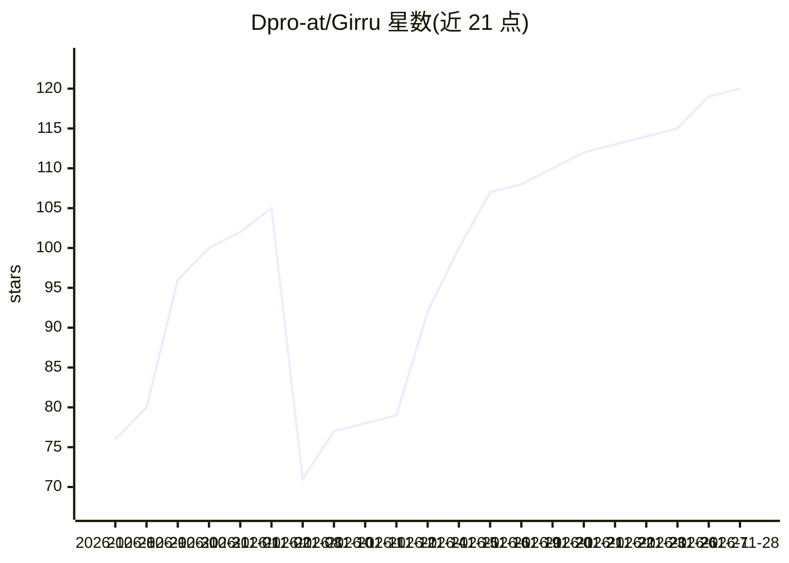

# Dpro-at/Girru

⭐ 120 · TypeScript · MIT · 推送 2026-11-27 · [GitHub](https://github.com/Dpro-at/Girru) · [官网](https://girru.dev) · 组织维护

**给个人与团队的本地优先 AI Agent 工作台**

自称 Agent OS 的开源桌面工作台：把对话、知识、任务、工具和多个 agent 角色组织到一个工作区，本地协调 agent 根据权限分配任务。核心机制是统一记忆系统——按主题组织记忆、关键词+语义检索（支持阿拉伯语方言）、知识图谱、变更版本化与回收站、来源标注；并可通过 AGENTS.md 与 MCP 记忆服务器让 Claude Code、Codex 等编码工具共享同一项目记忆。支持订阅连接、API 连接与本地模型三种方式，未完成功能较多（多处标注 roadmap/in development），合规声明仅为设计目标而非认证。

## 筛选速览

| 维度 | 判定 | 备注 |
|---|---|---|
| AI 角色 | `ai-ecosystem` | LLM/agent 周边工具 |
| 许可风险 | `permissive` | MIT |
| 部署形态 | `desktop` | 安装包/桌面程序 |
| 模型依赖 | local-ok | 支持本地模型 |
| 硬件要求 | — | 无带数字的原话,不猜 |
| 安装摩擦 | `low` | 无编译、无系统依赖或容器化 |
| 成熟度 | `idea` | |

## 能力要点

- 统一记忆系统：版本化、回收站、来源标注、阿拉伯语语义检索
- 通过 AGENTS.md 与 MCP 让多个编码工具共享同一份项目记忆
- 本地优先：协调、过滤与后台记忆工作可在本机运行
- 内置 Store 分发应用、扩展、MCP 服务器与技能

## 适用场景

- 把多个 AI 助手组织成分工明确的团队协作完成任务
- 让项目知识在多个 agent 和编码工具之间保持同步
- 要求工作数据留在本地的团队部署 AI 工作流

## 场景标签

`AI 助手` `知识图谱` `Agent 记忆` · 领域:Agent 开发

## 证据(README 行号)

> L7: An open-source operating system for AI agents—bringing your agents, models, tools, and projects into one workspace.
> L45: Girru brings conversations, knowledge, tasks, tools, and agent roles into a connected workspace. Organise agents in
> L57: Use supported local models alongside connected providers such as OpenAI, Anthropic, and Google. Available connectio

## 星数曲线

2026-10-28 76 → 2026-11-28 120（+44）

---
*卡片 v1 · prompt 1.4 · 生成 2026-11-28 · 置信度 high · 依据 README sha `f3df7d7e69d1` · [字段定义](../../DATASET.md)*
