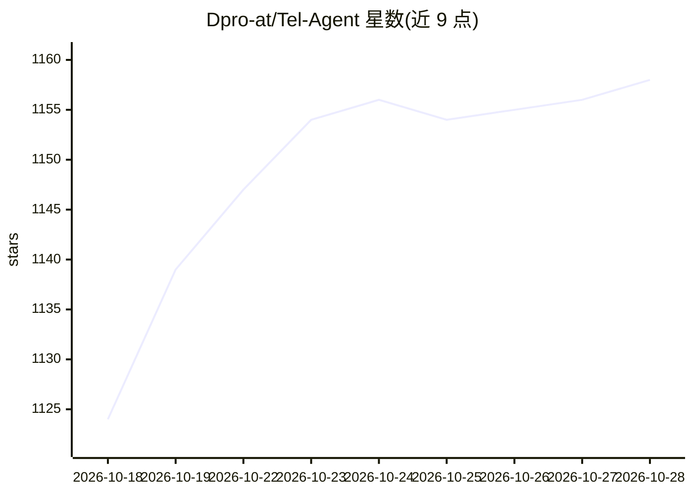

# Dpro-at/Tel-Agent

⭐ 1,159 · Python · AGPL-3.0 · 推送 2026-10-08 · [GitHub](https://github.com/Dpro-at/Tel-Agent) · [官网](https://Tel-Agent.com) · 组织维护

**自托管 AI 电话助理网关：SIP 电话线接入 AI agent**

开源网关，部署于自有硬件与局域网，连接 SIP 电话线与 AI agent：来电按路由规则转人工、拦截或交给 AI 实时对话（流式 STT/LLM/TTS），支持转接、留言、日历查询与 HTTP 工具调用，通话录音、转写、可检索。同一 agent 兼答 web 聊天、SMS、邮件、WhatsApp 等渠道（v1 已接 9 个消息渠道，24 个渠道规划中）。非 PBX 替代品，需作为 3CX/Asterisk/FreePBX 的分机接入；自带 API key，Alpha 阶段，由维也纳 Dpro GmbH 维护。

## 筛选速览

| 维度 | 判定 | 备注 |
|---|---|---|
| AI 角色 | `ai-native` | 本体是模型或模型工具 |
| 许可风险 | `viral` | AGPL-3.0 |
| 部署形态 | `desktop` | 安装包/桌面程序 |
| 模型依赖 | local-ok | 支持本地模型 |
| 硬件要求 | — | 无带数字的原话,不猜 |
| 安装摩擦 | `low` | 无编译、无系统依赖或容器化 |
| 成熟度 | `idea` | |

## 能力要点

- SIP 来电路由：转人工/拦截/AI 接听，通话录音转写可检索
- 24 渠道规划，v1 已覆盖电话与 9 个核心消息渠道
- 支持 OpenAI/Claude/Gemini/Ollama 等多模型，自带 key 自托管
- 提供 Windows/macOS/Linux 安装包、Docker Compose 与源码运行

## 适用场景

- 企业把现有电话线接入 AI 前台，转接留言查日程
- 同一 AI 助手同时接听电话与回复 WhatsApp/Telegram 等消息
- 数据不出本地：自托管通话录音与转写

## 场景标签

`语音 Agent` `AI 助手` · 领域:对话与助手

## 证据(README 行号)

> L74: Tel-Agent is an open-source gateway that sits between a phone line and an AI agent.
> L77: either passes it through to a human, blocks it, or hands it to an AI agent. The agent
> L117: **What works now.** A conversation is answered end to end: the reply streams token by
> L119: knows someone wrote in. The phone implementation includes streaming speech recognition and synthesis, interruption

## 星数曲线

2026-10-18 1,124 → 2026-10-28 1,158（+34）

---
*卡片 v1 · prompt 1.4 · 生成 2026-10-21 · 置信度 high · 依据 README sha `96015130c668` · [字段定义](../../DATASET.md)*
