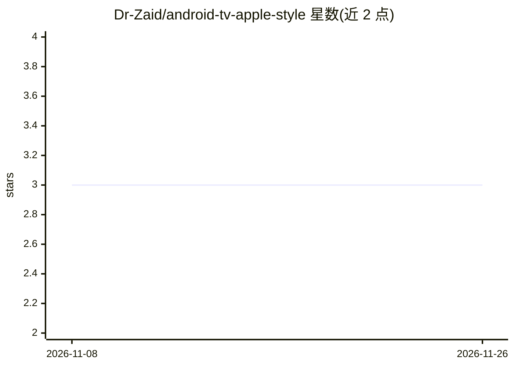

# Dr-Zaid/android-tv-apple-style

⭐ 3 · Java · MIT · 推送 2026-11-01 · [GitHub](https://github.com/Dr-Zaid/android-tv-apple-style) · [官网](https://zaidaiclass.com) · 个人维护

**让 Claude Code 把 Android TV 改成 Apple TV 风格的提示词与工具包**

一个由阿拉伯语 README 描述的个人项目：包含 PROMPT.md 快速提示词、PROMPT-FULL.md 完整提示词、基于 CleanYourTV 的 launcher 补丁、比赛卡片小应用与测速/安装脚本。用户在电脑上用 Claude Code 打开仓库，Claude 通过 ADB 连接 Android TV/Google TV，按问答收集偏好后执行清理预装应用（禁用不删除）、安装 Apple TV 风格界面、可选比赛直播卡片，并生成备份与恢复脚本。要求 Claude Code Pro/Max 订阅，Mac/Windows 电脑与电视同一 Wi-Fi（约 3 GB 空间，Claude 会安装 Python/Java/Android SDK）。不适用于 Samsung Tizen、LG webOS、Roku、Fire TV 等。

## 筛选速览

| 维度 | 判定 | 备注 |
|---|---|---|
| AI 角色 | `ai-native` | 本体是模型或模型工具 |
| 许可风险 | `permissive` | MIT |
| 部署形态 | `None` |  |
| 模型依赖 | locked-api |  |
| 硬件要求 | — | 无带数字的原话,不猜 |
| 安装摩擦 | `low` | 无编译、无系统依赖或容器化 |
| 成熟度 | — | 结构信号不足 |

## 能力要点

- git clone 后在 Claude Code 输入 start 即按问答流程执行
- 预装应用只 disable 不删除，附一键恢复脚本，结束前指导关闭 ADB
- 可用自然语言描述定制背景、列数、dock、焦点动效等界面元素
- 可选比赛卡片：下一场赛程、实时比分与进球悬浮提醒（ESPN 非官方 feed）

## 适用场景

- 把小米/TCL/索尼等 Android TV 的界面改成 Apple TV 风格
- 清理电视上的追踪类与广告类预装应用
- 给自己球队的比赛加桌面卡片与进球提醒

## 场景标签

 · 领域:消费电子/电视系统定制

## 证据(README 行号)

> L3: **سوّي clone للريبو، افتحه بـ Claude Code، وجاوب على كم سؤال. Claude يسوي الباقي.**
> L18: claude        # افتح Claude Code هنا واكتب: start
> L21: 1. Claude يسألك **مرة وحدة**: شنو تلفزيونك، وتطبيقات الـ dock، وشنو الشكل اللي تريده، وفريقك (أو لا أحد)، وشنو يصير

## 星数曲线

2026-11-08 3 → 2026-11-26 3（+0）

---
*卡片 v1 · prompt 1.4 · 生成 2026-11-22 · 置信度 high · 依据 README sha `e2cf3fbbea42` · [字段定义](../../DATASET.md)*
