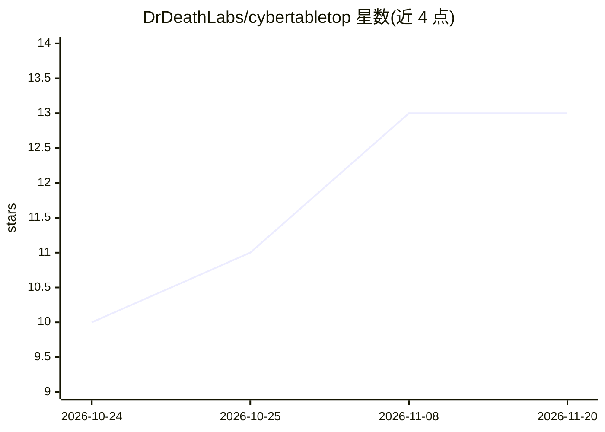

# DrDeathLabs/cybertabletop

⭐ 13 · TypeScript · NOASSERTION · 推送 2026-07-21 · [GitHub](https://github.com/DrDeathLabs/cybertabletop) · [官网](https://github.com/darrenmdeath/cybertabletop#readme) · 个人维护

**自托管网络安全桌面演练平台，AI 生成情景与实时演练**

面向安全团队的自托管桌面推演（tabletop）平台，用于运行有计分的事件响应演练：支持 AI 生成与 AI 驱动两种演练模式，主持者可在直播会话中控制节奏、推进注入事件、实时计分，并输出面向 NIST CSF 的复盘与差距分析。内置勒索软件、BEC、DDoS、内部威胁等情景与自定义情景构建器。技术栈为 Docker Compose 部署的 PostgreSQL、Redis、前端、后端与 Nginx，支持 TOTP MFA、RBAC 与审计日志。许可为 BUSL 1.1，托管与商业转售需另行授权。

## 筛选速览

| 维度 | 判定 | 备注 |
|---|---|---|
| AI 角色 | `ai-enhanced` | 去掉 AI 部分产品仍成立 |
| 许可风险 | `none` | NOASSERTION |
| 部署形态 | `self-host` | docker 或自建部署 |
| 模型依赖 | local-ok | 支持本地模型 |
| 硬件要求 | — | 无带数字的原话,不猜 |
| 安装摩擦 | `low` | 无编译、无系统依赖或容器化 |
| 成熟度 | — | 结构信号不足 |

## 能力要点

- AI Generated 与 AI-Driven 两种演练模式，主持者全程可控
- 支持 Anthropic Claude、Ollama 与确定性 scripted 内容三种 provider
- 实时计分、响应分布与 NIST CSF 导向复盘输出
- TOTP MFA 强制 privileged 角色、RBAC、审计日志与 Docker Compose 部署

## 适用场景

- SOC 与事件响应团队的演练训练
- 高管层网络危机模拟
- 高校与网络安全课堂教学实验
- 内部安全意识与决策练习

## 场景标签

`网络安全` · 领域:学习与行业

## 证据(README 行号)

> L3: CyberTabletop is an agentic AI cybersecurity tabletop platform for running live, scored incident response exercises.
> L44: - Deterministic scripted mode for built-in content and offline fallback

## 星数曲线

2026-10-24 10 → 2026-11-20 13（+3）

---
*卡片 v1 · prompt 1.4 · 生成 2026-11-19 · 置信度 high · 依据 README sha `a16dbce6eddb` · [字段定义](../../DATASET.md)*
