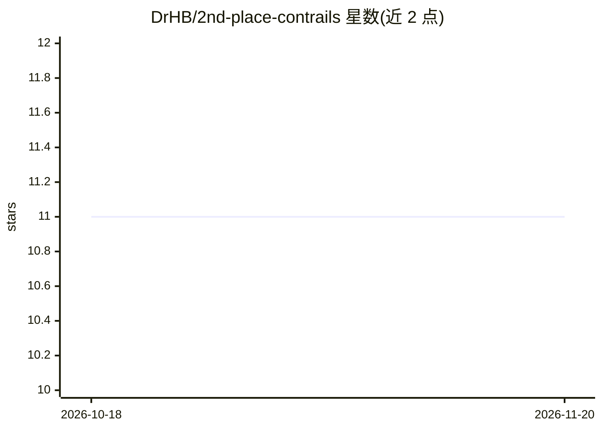

# DrHB/2nd-place-contrails

⭐ 11 · Python · 推送 2026-01-28 · [GitHub](https://github.com/DrHB/2nd-place-contrails) · 个人维护

**卫星图像尾迹检测的多编码器分割模型实现**

Google Research 主办 Kaggle 竞赛的第二名解决方案（954 支队伍），提供多编码器语义分割模型的训练与推理代码，用于从 GOES-16 地球同步卫星图像中分割飞机凝结尾迹。架构包含 CoaT、NeXtViT、SAM 三类编码器，采用 5 帧 LSTM 时序建模与多模型集成，损失函数为直接优化 IoU 的 Lovasz Loss。安装依赖 requirements.txt，训练需另行下载预训练权重，数据来自 Kaggle 竞赛数据集。

## 筛选速览

| 维度 | 判定 | 备注 |
|---|---|---|
| AI 角色 | `ai-native` | 本体是模型或模型工具 |
| 许可风险 | `none` | — |
| 部署形态 | `library` | 以包/库形式分发 |
| 模型依赖 | — | README 未给出锁定关系 |
| 硬件要求 | — | 无带数字的原话,不猜 |
| 安装摩擦 | `medium` | 含编译或系统依赖之一 |
| 成熟度 | — | 结构信号不足 |

## 能力要点

- CoaT/NeXtViT/SAM 多编码器分割架构
- 5 帧 LSTM 序列建模捕捉尾迹随时间演化
- Lovasz Loss 直接优化 IoU 分割边界
- 时序与单帧模型集成推理

## 适用场景

- 从 GOES-16 卫星影像中检测飞机凝结尾迹
- 复现 Kaggle 竞赛方案进行分割模型训练
- 研究多帧时序分割模型的集成策略

## 场景标签

`目标检测` `模型训练` · 领域:感知与多模态

## 证据(README 行号)

> L8: **Multi-encoder segmentation models for detecting aircraft contrails in GOES-16 satellite data**
> L14: This solution uses multi-frame temporal models and vision transformers to segment contrails from GOES-16 geostation

## 星数曲线

2026-10-18 11 → 2026-11-20 11（+0）

---
*卡片 v1 · prompt 1.4 · 生成 2026-11-19 · 置信度 high · 依据 README sha `c7fd95b4c2ac` · [字段定义](../../DATASET.md)*
