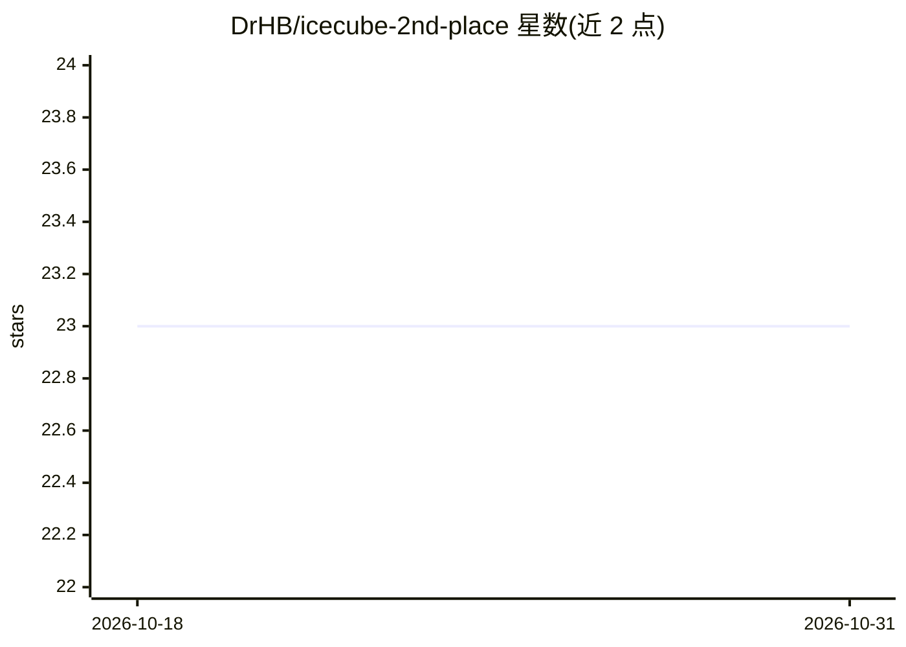

# DrHB/icecube-2nd-place

⭐ 23 · Python · MIT · 推送 2026-01-28 · [GitHub](https://github.com/DrHB/icecube-2nd-place) · 个人维护

**面向科研者的 IceCube 中微子方向重建 Transformer+GNN 方案**

Kaggle IceCube 中微子检测竞赛第 2 名（901 队）方案的开源实现，也是已发表于 European Physical Journal C 的研究工作。模型从 5,160 个光学传感器的稀疏光子脉冲数据中回归中微子到达方向：Transformer 编码器（BEiTv2 式注意力）结合图注意力 GNN 层，用 Von Mises-Fisher 概率损失做球面 3D 方向回归，并以 5 个模型变体的加权集成输出预测。提供数据准备、训练与推理脚本，需自行从 Kaggle 下载竞赛数据，推荐使用带 CUDA 的 nvidia/kaggle Docker 镜像运行。

## 筛选速览

| 维度 | 判定 | 备注 |
|---|---|---|
| AI 角色 | `ai-native` | 本体是模型或模型工具 |
| 许可风险 | `permissive` | MIT |
| 部署形态 | `library` | 以包/库形式分发 |
| 模型依赖 | — | README 未给出锁定关系 |
| 硬件要求 | — | 无带数字的原话,不猜 |
| 安装摩擦 | `medium` | 含编译或系统依赖之一 |
| 成熟度 | — | 结构信号不足 |

## 能力要点

- Transformer 编码器 + GNN 图注意力处理最多 768 个脉冲的变长序列
- Von Mises-Fisher 损失用于球面 3D 方向回归
- 5 个模型变体的加权集成推理
- cascade 事件角分辨率 <5°，track 事件 <0.5°（>10 TeV）

## 适用场景

- 复现竞赛第 2 名的中微子方向重建结果
- 基于 IceCube 传感器数据做中微子天文学研究
- 参考 Transformer+GNN 处理稀疏点云/脉冲序列的建模方法

## 场景标签

`科研工具` · 领域:学习与行业

## 证据(README 行号)

> L8: **Transformer + GNN architecture for reconstructing neutrino arrival directions from IceCube optical sensor data**
> L35: This repository contains the implementation of a Transformer + GNN architecture for neutrino direction reconstructi

## 星数曲线

2026-10-18 23 → 2026-10-31 23（+0）

---
*卡片 v1 · prompt 1.4 · 生成 2026-10-27 · 置信度 mid · 依据 README sha `9fe41173efbb` · [字段定义](../../DATASET.md)*
