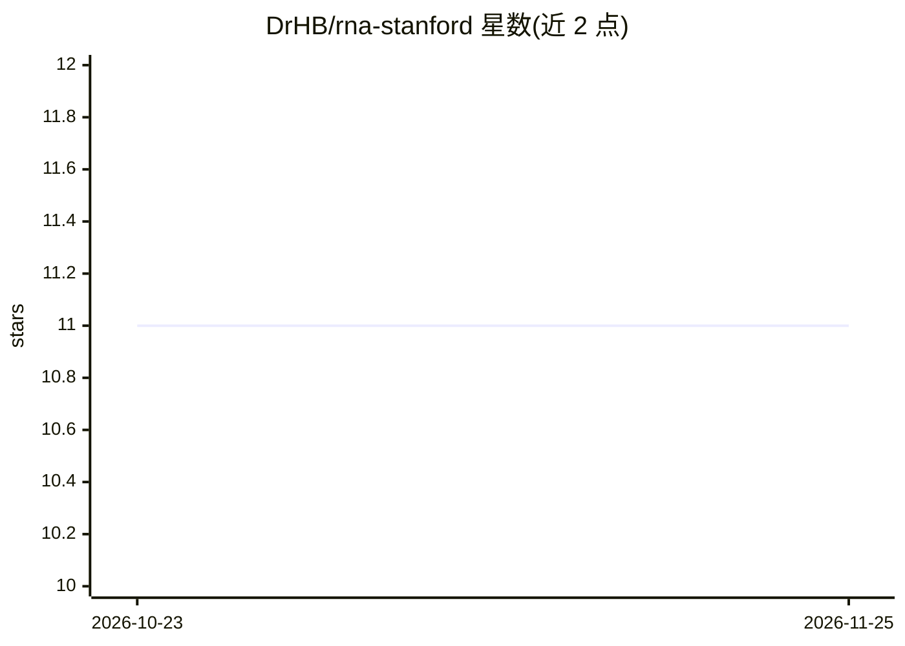

# DrHB/rna-stanford

⭐ 11 · Jupyter Notebook · 推送 2026-01-28 · [GitHub](https://github.com/DrHB/rna-stanford) · 个人维护

**面向生物信息科研者的 RNA 反应性预测模型代码**

Stanford Ribonanza 竞赛（第 7 名金牌）方案的源码：用 Transformer 编码器结合图注意力网络（GAT），以碱基配对概率（来自 Vienna、Contrafold、RNAformer）与二级结构特征作为图边，预测 RNA 序列的化学反应性；含伪标签自训练与门控残差融合，并附 19 个实验的配置与 CV/LB 结果表。数据需从官方页面下载，BPP/SS 特征推荐安装 arnie 生成；README 以 nvidia/kaggle CUDA 镜像为运行方式。

## 筛选速览

| 维度 | 判定 | 备注 |
|---|---|---|
| AI 角色 | `ai-native` | 本体是模型或模型工具 |
| 许可风险 | `none` | — |
| 部署形态 | `None` |  |
| 模型依赖 | — | README 未给出锁定关系 |
| 硬件要求 | — | 无带数字的原话,不猜 |
| 安装摩擦 | `medium` | 含编译或系统依赖之一 |
| 成熟度 | — | 结构信号不足 |

## 能力要点

- Transformer + GAT 混合架构做 RNA 反应性预测
- 融合 Vienna/Contrafold/RNAformer 多来源碱基配对概率
- 伪标签迭代自训练利用无标注序列
- 19 个实验的配置、交叉验证与榜单成绩记录

## 适用场景

- 复现 Stanford Ribonanza 竞赛方案结果
- 参考 Transformer+GAT 融合结构特征的建模方式
- 在化学映射数据上训练 RNA 结构预测模型

## 场景标签

`科研工具` · 领域:学习与行业

## 证据(README 行号)

> L9: **Transformer + Graph Attention Networks for predicting RNA chemical reactivity from sequence**
> L15: This solution combines transformers with graph neural networks using base pairing probabilities (BPP) and secondary

## 星数曲线

2026-10-23 11 → 2026-11-25 11（+0）

---
*卡片 v1 · prompt 1.4 · 生成 2026-11-19 · 置信度 high · 依据 README sha `a90ac0933744` · [字段定义](../../DATASET.md)*
