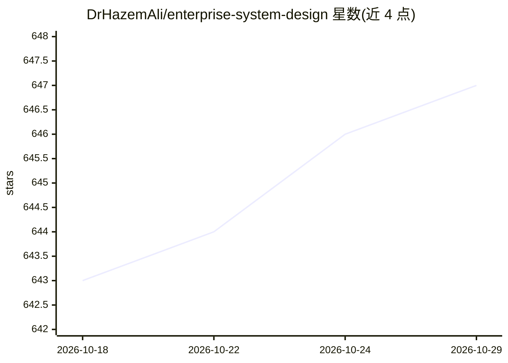

# DrHazemAli/enterprise-system-design

⭐ 647 · 推送 2026-08-22 · [GitHub](https://github.com/DrHazemAli/enterprise-system-design) · 个人维护

**面向工程师的企业系统设计课程与架构参考（Azure/AI 工作负载）**

基于 Azure 平台的企业分布式系统设计课程与技术参考：从系统设计基础机制出发，逐请求追踪身份、网络、API、数据、队列、模型与恢复路径；以 Azure Well-Architected Framework 作为复评视角，覆盖 AI 控制平面、推理与服务、模型生命周期、安全治理、边缘与混合等 11 个模块。另提供 Hazem's Principles 原则集（六大学科）与 RAG 证据流、推理生命周期等可视化图谱，每章产出设计产物（需求、信任边界、失败模式等）。通过 git clone 获取后按 foundation/README.md 开始学习。

## 筛选速览

| 维度 | 判定 | 备注 |
|---|---|---|
| AI 角色 | `ai-knowledge` | 知识聚合/清单类 |
| 许可风险 | `none` | — |
| 部署形态 | `None` |  |
| 模型依赖 | — | README 未给出锁定关系 |
| 硬件要求 | — | 无带数字的原话,不猜 |
| 安装摩擦 | `low` | 无编译、无系统依赖或容器化 |
| 成熟度 | — | 结构信号不足 |

## 能力要点

- 11 个模块的课程体系，覆盖云、AI 控制平面、推理服务、HPC、边缘等
- 以 Azure Well-Architected Framework 五大维度作为评审视角
- Hazem's Principles 原则集覆盖工程、AI 系统、网络安全等六学科
- 每章产出设计产物：架构、信任边界、失败模式、决策记录等

## 适用场景

- 系统学习企业分布式系统与 AI 工作负载的架构设计
- 在真实约束下做架构决策时查阅原则与模式参考
- 为生产 AI 系统设计检索、推理与治理路径

## 场景标签

`教程课程` · 领域:学习与行业

## 证据(README 行号)

> L3: An enterprise distributed systems design course and technical reference for building reliable, secure, and operable 
> L23: System design turns product requirements into explicit contracts for data, compute, networking, identity, capacity,

## 星数曲线

2026-10-18 643 → 2026-10-29 647（+4）

---
*卡片 v1 · prompt 1.4 · 生成 2026-10-21 · 置信度 high · 依据 README sha `30754a989394` · [字段定义](../../DATASET.md)*
