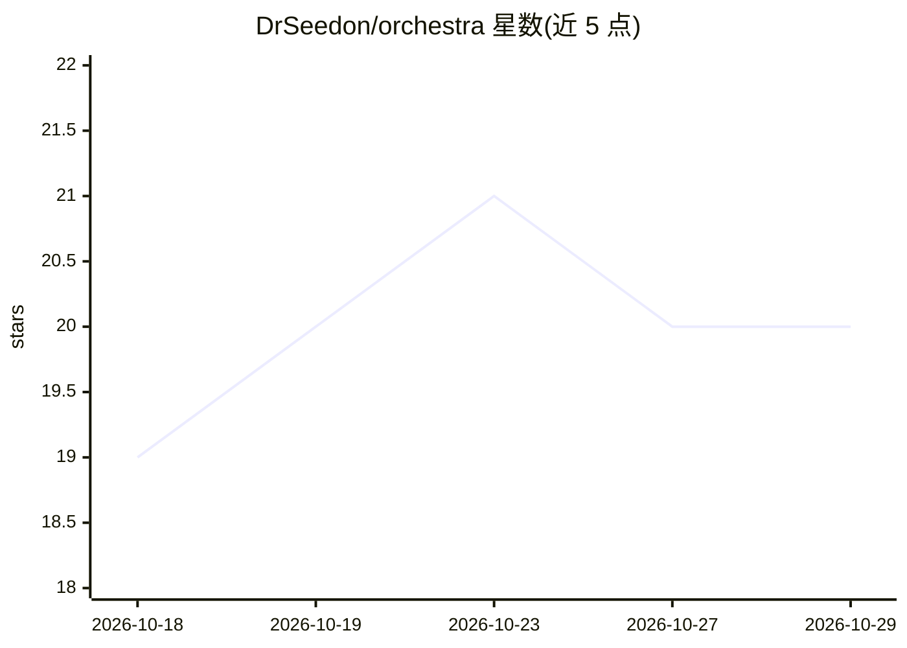

# DrSeedon/orchestra

⭐ 20 · Python · AGPL-3.0 · 推送 2026-10-28 · [GitHub](https://github.com/DrSeedon/orchestra) · 个人维护

**自托管持久 AI agent 团队管理平台，带任务分解与合并检查**

自托管的 AI agent 团队编排平台：用户向 orchestrator 描述目标，它分解任务、分派 worker，worker 在各自 Git worktree 中持久运行、可直接互发消息并维护跨轮次存续的 checklist；合并前执行映射测试与变更测试变异检查。支持 Claude Code、Codex、Grok CLI 运行时及进程内 Harness。提供 Web 仪表盘与可选 Telegram 桥接。限制：跨模型评审当前被策略冻结；shell 守卫仅拦截少量命令，非通用沙箱；项目检索为词法搜索，无向量检索。

## 筛选速览

| 维度 | 判定 | 备注 |
|---|---|---|
| AI 角色 | `ai-ecosystem` | LLM/agent 周边工具 |
| 许可风险 | `viral` | AGPL-3.0 |
| 部署形态 | `None` |  |
| 模型依赖 | — | README 未给出锁定关系 |
| 硬件要求 | — | 无带数字的原话,不猜 |
| 安装摩擦 | `low` | 无编译、无系统依赖或容器化 |
| 成熟度 | — | 结构信号不足 |

## 能力要点

- Worker 各自 Git worktree 隔离，会话可跨重启与休眠恢复
- 合并前运行映射测试与 changed-test 变异检查，失败即阻断
- agent 间直接消息通信与跨项目 orchestrator 协作
- 支持 Claude Code / Codex / Grok 运行时及进程内 Harness

## 适用场景

- 把一个代码目标交给 agent 团队规划、分工并完成评审合并
- 持续运行需要交接与验证的多步开发任务
- 通过仪表盘或 Telegram 监督 agent 团队进度与配额

## 场景标签

`多智能体` `编码 Agent` · 领域:Agent 开发

## 证据(README 行号)

> L20: **Orchestra is a self-hosted platform for managing persistent AI agent teams.** You describe an outcome to a projec

## 星数曲线

2026-10-18 19 → 2026-10-29 20（+1）

---
*卡片 v1 · prompt 1.4 · 生成 2026-10-28 · 置信度 high · 依据 README sha `e8316f5b9c65` · [字段定义](../../DATASET.md)*
