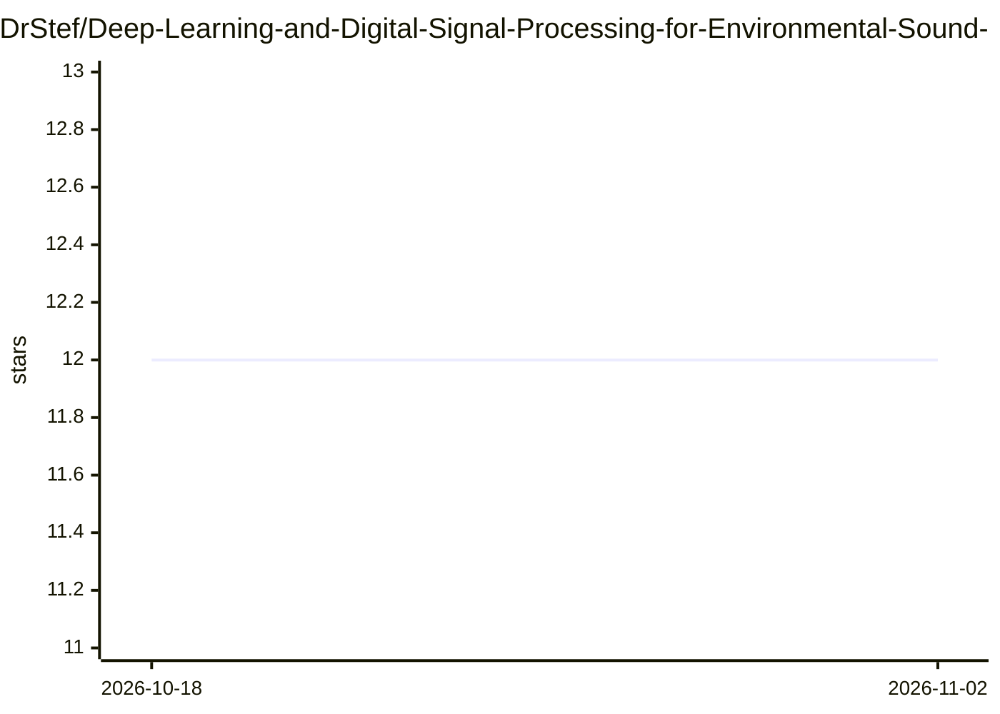

# DrStef/Deep-Learning-and-Digital-Signal-Processing-for-Environmental-Sound-Classification

⭐ 12 · Jupyter Notebook · MIT · 推送 2026-04-06 · [GitHub](https://github.com/DrStef/Deep-Learning-and-Digital-Signal-Processing-for-Environmental-Sound-Classification) · 个人维护

**环境声分类研究项目：小波变换+梅尔频谱融合 CNN**

由个人研究者维护的环境声分类（ESC）实验项目，基于 ESC-50/ESC-10 数据集。核心做法是将音频降采样至 22.05 kHz、截取 1.25 秒片段，生成灰度梅尔频谱图与复数连续小波变换（CWT）幅度/相位倒谱图，再训练 CNN；两阶段流程先分谐波/非谐波类再做细分类。融合 CWT+梅尔频谱在 ESC-10 上报告 99% 准确率，达到 100% 的 aT-CWT 变换未公开（confidential）。以 Jupyter Notebook 为主，另含 esc10_sound_classification 目录的可运行管线。

## 筛选速览

| 维度 | 判定 | 备注 |
|---|---|---|
| AI 角色 | `ai-native` | 本体是模型或模型工具 |
| 许可风险 | `permissive` | MIT |
| 部署形态 | `library` | 以包/库形式分发 |
| 模型依赖 | — | README 未给出锁定关系 |
| 硬件要求 | — | 无带数字的原话,不猜 |
| 安装摩擦 | `low` | 无编译、无系统依赖或容器化 |
| 成熟度 | — | 结构信号不足 |

## 能力要点

- 梅尔频谱图与复数 CWT（幅度+相位）特征融合训练 CNN
- 两阶段分类：先分谐波/非谐波声音类，再细分 10 类
- 融合方法在 ESC-10 报告 99% 准确率
- 提供 esc10_sound_classification/src/main.py 可运行管线

## 适用场景

- 复现 ESC-10 数据集上的声分类实验
- 研究小波变换与梅尔频谱结合的特征工程方法
- 学习音频信号预处理与 CNN 训练的完整流程

## 场景标签

`教程课程` · 领域:学习与行业

## 证据(README 行号)

> L18: Automatic environmental sound classification (ESC) based on ESC-50 dataset (and ESC-10 subset) built by Karol Picza
> L47: This project features a pipeline for environmental sound classification in the `esc10_sound_classification` directo

## 星数曲线

2026-10-18 12 → 2026-11-02 12（+0）

---
*卡片 v1 · prompt 1.4 · 生成 2026-11-01 · 置信度 mid · 依据 README sha `9c9e04a0bc9c` · [字段定义](../../DATASET.md)*
