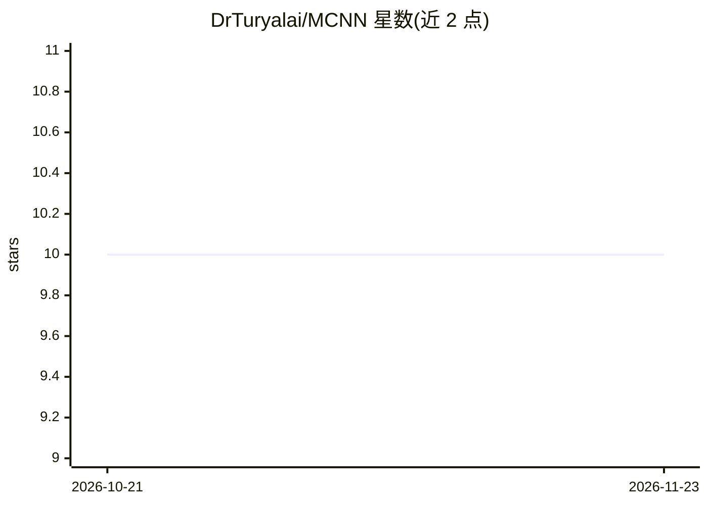

# DrTuryalai/MCNN

⭐ 10 · MATLAB · MIT · 推送 2026-02-21 · [GitHub](https://github.com/DrTuryalai/MCNN) · [官网](https://doi.org/10.1016/j.asoc.2023.111036) · 个人维护

**用矩形滤波器 MCNN 对 FHSS 信号时频图分类的研究实现**

论文配套代码：针对跳频扩频（FHSS）信号分类，将时频表示（TFR）当作图像输入，用矩形滤波器与区域内 max-pooling 的改进 CNN 提取特征；对类间样本不均衡采用随机擦除处理，在 −2 dB 信噪比下报告 80.44% 准确率。仓库提供 MATLAB 格式的训练后模型、各事件 FHSS 信号生成主文件用于构建数据集，以及托管在 Google Drive 的 TFR 图像数据集。要求用户在 MATLAB 中按文件附带说明运行与验证，测试数据须与对应事件匹配。

## 筛选速览

| 维度 | 判定 | 备注 |
|---|---|---|
| AI 角色 | `ai-native` | 本体是模型或模型工具 |
| 许可风险 | `permissive` | MIT |
| 部署形态 | `None` |  |
| 模型依赖 | — | README 未给出锁定关系 |
| 硬件要求 | — | 无带数字的原话,不猜 |
| 安装摩擦 | `low` | 无编译、无系统依赖或容器化 |
| 成熟度 | — | 结构信号不足 |

## 能力要点

- 矩形滤波器与区域 max-pooling 的改进 CNN 结构
- 随机擦除方法处理类别不均衡数据集
- 提供 MATLAB 格式的训练后模型与测试说明
- 提供 FHSS 信号生成代码与 TFR 图像数据集下载

## 适用场景

- 在含背景干扰与高斯噪声的电磁环境中分类 FHSS 信号
- 用提供的代码生成 FHSS 数据集并构建 TFR 图像
- 复现论文中 MCNN 的分类实验结果

## 场景标签

 · 领域:信号处理/深度学习科研

## 证据(README 行号)

> L1: # A modified convolutional neural network with rectangular filters for frequency-hopping spread spectrum signals
> L5: To test the trained MCNN, open the Trained MCNN file in MATLAB and follow the instructions given with the file.
> L12: The FHSS dataset comprising TFR images is available at: https://drive.google.com/file/d/1zdal5ZHB_6DX0s2GNINkhqVLvq

## 星数曲线

2026-10-21 10 → 2026-11-23 10（+0）

---
*卡片 v1 · prompt 1.4 · 生成 2026-11-20 · 置信度 high · 依据 README sha `de760084c0a9` · [字段定义](../../DATASET.md)*
