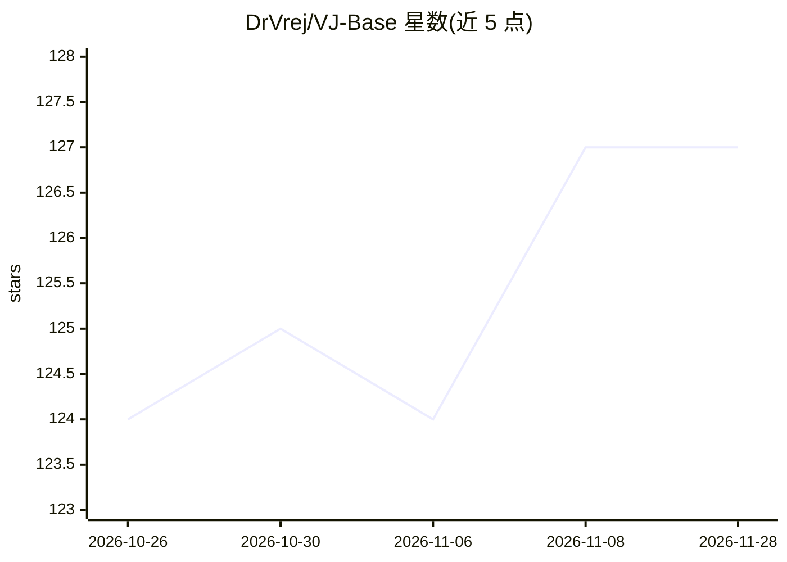

# DrVrej/VJ-Base

⭐ 127 · Lua · 推送 2026-11-26 · [GitHub](https://github.com/DrVrej/VJ-Base) · [官网](http://steamcommunity.com/sharedfiles/filedetails/?id=131759821) · 个人维护

**Garry's Mod 插件基础框架，用于开发 NPC、武器与实体插件**

VJ Base 于 2012 年建立，用于协助开发 Garry's Mod 插件。其以脚本化 NPC 基础框架最为知名，提供可自定义的人工智能系统（游戏内 NPC 行为）。README 本身内容简短，仅链接 Steam Workshop 页面查看功能列表，以及变更日志与文档。安装与分发通过 Steam Workshop 进行，使用 Lua/GLua 编写，面向 Source 引擎的游戏模组开发者。

## 筛选速览

| 维度 | 判定 | 备注 |
|---|---|---|
| AI 角色 | `ai-enhanced` | 去掉 AI 部分产品仍成立 |
| 许可风险 | `none` | — |
| 部署形态 | `None` |  |
| 模型依赖 | — | README 未给出锁定关系 |
| 硬件要求 | — | 无带数字的原话,不猜 |
| 安装摩擦 | `low` | 无编译、无系统依赖或容器化 |
| 成熟度 | — | 结构信号不足 |

## 能力要点

- 提供可自定义的 NPC、武器与实体插件开发基础框架
- 脚本化 NPC 基础带可自定义的人工智能系统（游戏内 NPC 行为）
- 通过 Steam Workshop 分发，附文档与变更日志

## 适用场景

- 为 Garry's Mod 开发自定义 NPC 插件
- 基于该基础框架制作武器与实体模组

## 场景标签

 · 领域:游戏模组/插件开发

## 证据(README 行号)

> L2: VJ Base, short for Vrej Base, was established in 2012 with the aim of assisting in the development of Garry's Mod ad

## 星数曲线

2026-10-26 124 → 2026-11-28 127（+3）

---
*卡片 v1 · prompt 1.4 · 生成 2026-11-28 · 置信度 mid · 依据 README sha `963cd3668b7a` · [字段定义](../../DATASET.md)*
