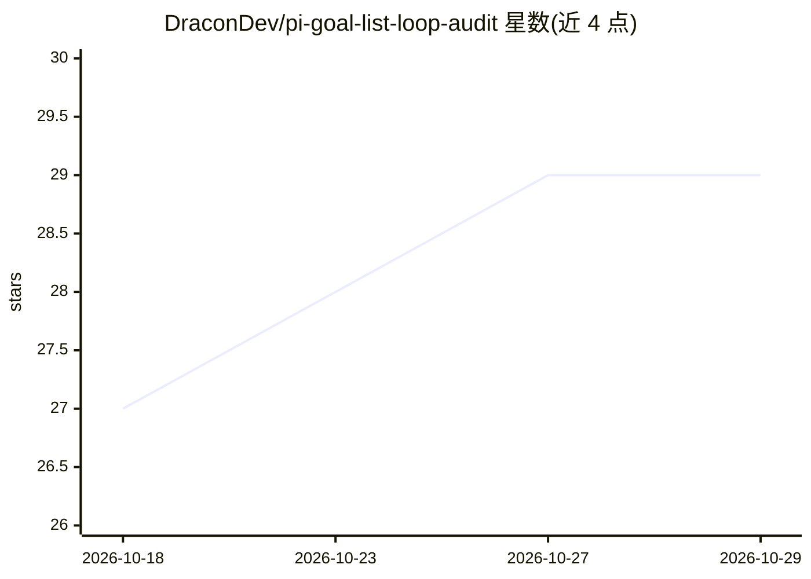

# DraconDev/pi-goal-list-loop-audit

⭐ 29 · TypeScript · AGPL-3.0 · 推送 2026-10-28 · [GitHub](https://github.com/DraconDev/pi-goal-list-loop-audit) · [官网](https://pi.dev/packages/pi-goal-list-loop-audit) · 个人维护

**Pi 编码代理的长期任务监督扩展：目标跟踪与完成审计**

GLLA 是 Pi 编码代理的扩展包，将长期开发工作转为受监督过程：通过 /goal /list /loop 命令约定目标与验收标准，跨轮次持续推进、从中断恢复，并由独立审计进程在全新 Pi 会话中核验完成声明，被拒绝的声明返回工作而非结束。状态（目标、队列、审计、归档）持久化于 .pi-glla/，支持上下文自动压缩与有界恢复。要求 Pi >=0.84.2 <2.0.0 与 Node 22.19+。面向使用 Pi 的开发者，非模型或托管服务。

## 筛选速览

| 维度 | 判定 | 备注 |
|---|---|---|
| AI 角色 | `ai-ecosystem` | LLM/agent 周边工具 |
| 许可风险 | `viral` | AGPL-3.0 |
| 部署形态 | `library` | 以包/库形式分发 |
| 模型依赖 | — | README 未给出锁定关系 |
| 硬件要求 | — | 无带数字的原话,不猜 |
| 安装摩擦 | `low` | 无编译、无系统依赖或容器化 |
| 成熟度 | — | 结构信号不足 |

## 能力要点

- 独立审计进程核验完成声明，被拒声明返回工作
- goal/list/loop 三种工作形态，含规格驱动项目构建
- 中断恢复与持久化状态（.pi-glla/ 目录）
- 上下文自动压缩，不安全边界强制执行

## 适用场景

- 让编码代理跨多轮次完成跨子系统的大功能或迁移
- 按 SPEC.md 规格驱动构建项目并逐项验证
- 以可度量指标做反复改进循环
- 审计代理声称完成的工作是否真实达标

## 场景标签

 · 领域:开发工具/编码代理

## 证据(README 行号)

> L3:  GLLA work supervision in Pi
> L12: pi install npm:pi-goal-list-loop-audit
> L47: GLLA supplies that supervision inside Pi.

## 星数曲线

2026-10-18 27 → 2026-10-29 29（+2）

---
*卡片 v1 · prompt 1.4 · 生成 2026-10-26 · 置信度 mid · 依据 README sha `af6338f479ab` · [字段定义](../../DATASET.md)*
