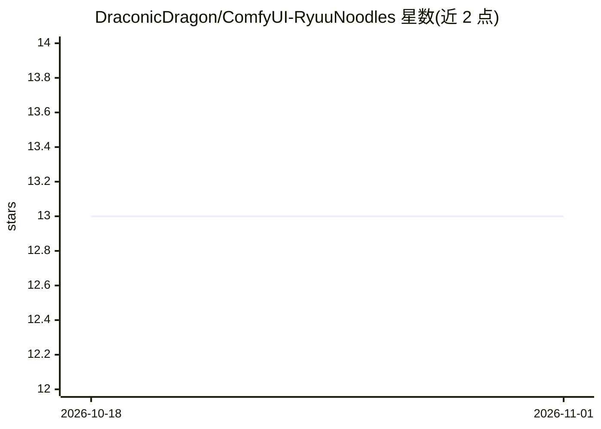

# DraconicDragon/ComfyUI-RyuuNoodles

⭐ 13 · Python · GPL-3.0 · 推送 2026-07-12 · [GitHub](https://github.com/DraconicDragon/ComfyUI-RyuuNoodles) · 个人维护

**ComfyUI 自定义节点合集：token 计数器、回退切换与文本工具**

面向 ComfyUI 用户的自定义节点包，主要供作者个人使用。核心节点为可挂载到任意文本框上的实时 token 计数器，支持 CLIP_L、T5、Gemma2/3、LlaMA3、Qwen2.5VL 等多种 tokenizer，tokenizer 按需经 huggingface_hub 下载缓存（约 20-40MB，不含模型）；另提供带回退的双输入切换节点、Passthrough 节点、字符串清理节点、限定范围的数字/滑块节点及 bypass 友好的颜色匹配节点。计数器不支持 ComfyUI 前端 Nodes 2.0，也不支持 embeddings 与通配符语法。

## 筛选速览

| 维度 | 判定 | 备注 |
|---|---|---|
| AI 角色 | `ai-ecosystem` | LLM/agent 周边工具 |
| 许可风险 | `viral` | GPL-3.0 |
| 部署形态 | `None` |  |
| 模型依赖 | — | README 未给出锁定关系 |
| 硬件要求 | — | 无带数字的原话,不猜 |
| 安装摩擦 | `low` | 无编译、无系统依赖或容器化 |
| 成熟度 | — | 结构信号不足 |

## 能力要点

- 可在任意文本框上挂载的实时 token 计数器，支持 9 种 tokenizer
- tokenizer 按需下载并缓存以加快启动（约 20-40MB）
- 支持空值回退的切换/Passthrough 节点
- 字符串清理与限定范围的数字/滑块节点

## 适用场景

- 写提示词时实时查看不同 tokenizer 的 token 数
- 搭建工作流时用带回退的切换节点处理被 bypass 的输入
- 清理和规范化提示词文本

## 场景标签

`提示工程` · 领域:Agent 开发

## 证据(README 行号)

> L5: Collection of one or more custom nodes for ComfyUI made mainly for personal use ...rawr...
> L22: No CLIP input required. With this repo/custom nodes you'll have the ability to add a token counter with variable to
> L31: - Supported tokenizers: `CLIP_L, T5, T5_Fast, UMT5, Gemma2, Gemma3, LlaMA3, Qwen2.5VL, AuraFlow` (case insensitive)

## 星数曲线

2026-10-18 13 → 2026-11-01 13（+0）

---
*卡片 v1 · prompt 1.4 · 生成 2026-10-31 · 置信度 high · 依据 README sha `49bc46ba3a96` · [字段定义](../../DATASET.md)*
