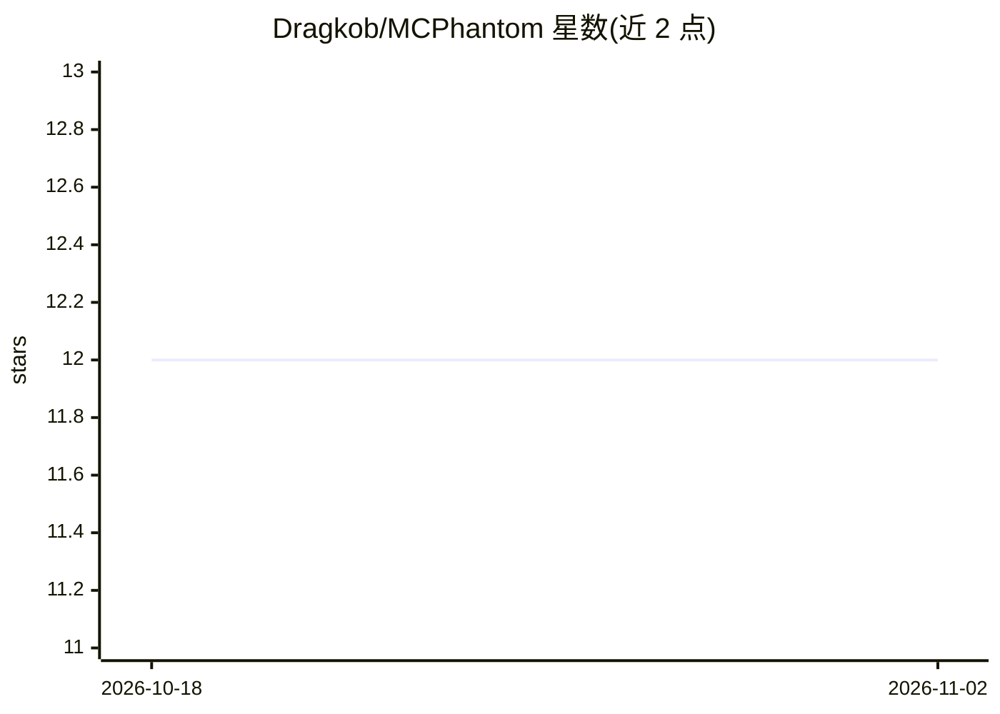

# Dragkob/MCPhantom

⭐ 12 · Python · MIT · 推送 2026-07-17 · [GitHub](https://github.com/Dragkob/MCPhantom) · 个人维护

**MCP 端点安全侦察与测试的本地 Web 控制台**

面向安全测试人员的本地 Web 仪表盘：输入任意 MCP URL 后枚举其暴露的 resources、templates、tools 与 prompts，并对能力打标签（URL/命令/数据库等），再从浏览器控制台直接读取资源、调用工具或运行自动化检查。内置 SQL 注入、命令注入、SSRF、路径穿越、IDOR 与信息泄露六类插件，负载集中在 payloads.py，可通过 plugin_loader.py 扩展。项目自我声明为需按目标调优的起点框架而非通用扫描器，AutoPwn 为 WIP。

## 筛选速览

| 维度 | 判定 | 备注 |
|---|---|---|
| AI 角色 | `ai-ecosystem` | LLM/agent 周边工具 |
| 许可风险 | `permissive` | MIT |
| 部署形态 | `None` |  |
| 模型依赖 | — | README 未给出锁定关系 |
| 硬件要求 | — | 无带数字的原话,不猜 |
| 安装摩擦 | `low` | 无编译、无系统依赖或容器化 |
| 成熟度 | `idea` | |

## 能力要点

- 枚举 MCP 端点的 resources/templates/tools/prompts 并打能力标签
- 六类漏洞检查插件（SQLi/命令注入/SSRF/路径穿越/IDOR/信息泄露）
- 集中式负载仓库与模块化插件加载器，支持扩展新漏洞类别
- 并行执行、NDJSON 流式进度与逐能力覆盖率报告

## 适用场景

- 对自有 MCP 服务端做授权安全评估与漏洞测试
- 交互式审查 MCP 端点暴露的资源与工具
- 在 CTF 或本地靶场中测试 AutoPwn 自动化扫描

## 场景标签

`网络安全` · 领域:学习与行业

## 证据(README 行号)

> L3: **MCPhantom** is a local web dashboard for MCP endpoint reconnaissance and exploitation. Point it at any MCP URL, di
> L27:  Discovers resources, resource templates, tools, and prompts from a target MCP endpoint

## 星数曲线

2026-10-18 12 → 2026-11-02 12（+0）

---
*卡片 v1 · prompt 1.4 · 生成 2026-11-01 · 置信度 high · 依据 README sha `8bba8cf3c58b` · [字段定义](../../DATASET.md)*
