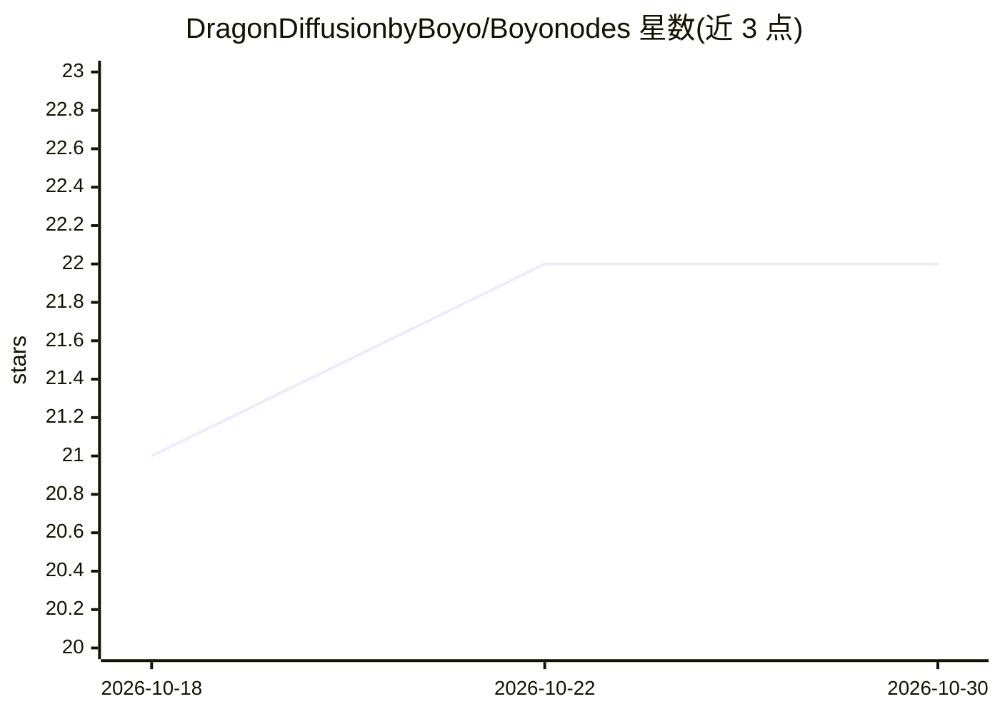

# DragonDiffusionbyBoyo/Boyonodes

⭐ 22 · Python · MIT · 推送 2026-10-16 · [GitHub](https://github.com/DragonDiffusionbyBoyo/Boyonodes) · 个人维护

**ComfyUI 自定义节点集：覆盖 TTS、视频、LoRA、循环工作流等**

面向 ComfyUI 用户的自定义节点集合，功能包括：Chatterbox Turbo TTS 语音生成与 Seed-VC 语音增强、Qwen2.5-VL 视觉定位、LoRA 配置管理、视频剪辑与逐帧处理、While/For 循环与流程控制节点、Latent 缓存与 VACE 控制注入，以及 LUT 调色等通用工具。安装方式为 git clone 复制到 custom_nodes 目录，多数节点无额外依赖，音视频相关节点需 pip 安装依赖与 FFmpeg，采用 MIT 许可。

## 筛选速览

| 维度 | 判定 | 备注 |
|---|---|---|
| AI 角色 | `ai-ecosystem` | LLM/agent 周边工具 |
| 许可风险 | `permissive` | MIT |
| 部署形态 | `library` | 以包/库形式分发 |
| 模型依赖 | local-ok | 支持本地模型 |
| 硬件要求 | — | 无带数字的原话,不猜 |
| 安装摩擦 | `medium` | 含编译或系统依赖之一 |
| 成熟度 | — | 结构信号不足 |

## 能力要点

- Chatterbox Turbo TTS 加载与语音生成节点（情感标签、可选声音克隆）
- LoRA 配置构建/加载/检查等 7 个管理节点
- While/For 循环、Prompt 循环与 Latent 缓存等迭代工作流节点
- Boyo Asset Grabber 按 JSON 清单下载节点、模型与 pip 包

## 适用场景

- 在 ComfyUI 中搭建带语音生成的视频工作流
- 批量 LoRA 训练/应用时管理多套配置
- 构建迭代式图像编辑或无限视频的循环流程

## 场景标签

`语音合成` `图像生成` `图像视频处理` · 领域:内容生成

## 证据(README 行号)

> L5: Custom ComfyUI nodes for audio/TTS, video generation, LoRA management, looping workflows, semantic image editing, an
> L54: |Boyo Chatterbox Turbo Loader|Load the Chatterbox Turbo TTS model onto GPU or CPU.|

## 星数曲线

2026-10-18 21 → 2026-10-30 22（+1）

---
*卡片 v1 · prompt 1.4 · 生成 2026-10-27 · 置信度 mid · 依据 README sha `1a6c86826ef7` · [字段定义](../../DATASET.md)*
