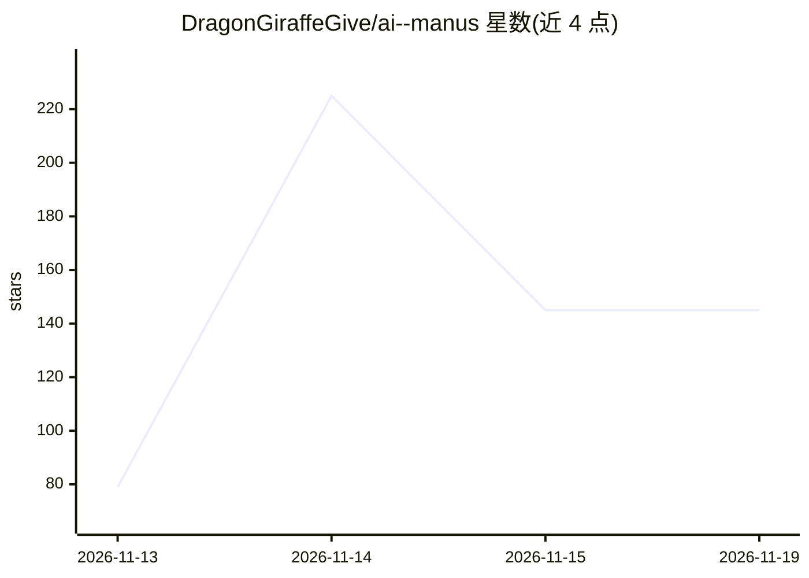

# DragonGiraffeGive/ai--manus

⭐ 145 · Apache-2.0 · 推送 2026-11-15 · [GitHub](https://github.com/DragonGiraffeGive/ai--manus) · 个人维护

**面向日常任务的自主 AI Agent：代用户执行代码与浏览器操作**

README 以介绍性文字描述一个自主 AI Agent：接收自然语言指令后代为编写并执行脚本、控制浏览器（导航网页、填写表单、抓取信息），并执行多步骤日常任务，定位为家庭、学习与轻量办公场景的个人助手，面向非开发者用户。提供兼容性表（最低双核 CPU / 4 GB 内存）与上手、维护步骤说明。但 README 未给出具体的安装命令、运行方式、技术架构或模型接入细节，仅含下载入口与推广码，可验证的实现信息有限。

## 筛选速览

| 维度 | 判定 | 备注 |
|---|---|---|
| AI 角色 | `ai-native` | 本体是模型或模型工具 |
| 许可风险 | `permissive` | Apache-2.0 |
| 部署形态 | `None` |  |
| 模型依赖 | — | README 未给出锁定关系 |
| 硬件要求 | — | 无带数字的原话,不猜 |
| 安装摩擦 | `low` | 无编译、无系统依赖或容器化 |
| 成熟度 | — | 结构信号不足 |

## 能力要点

- 自主执行代码与控制浏览器完成多步骤任务
- 面向非开发者，用自然语言描述需求即可委托任务
- 兼容性要求：现代 64 位系统、双核 CPU、4 GB 内存起步
- 会话间保持任务模式的一致性，支持后台常驻响应

## 适用场景

- 用自然语言委托 AI 代为跑脚本和操作网页完成琐事
- 学习研究中自动收集资料、整理笔记
- 轻量办公中跨多个网页汇总信息、准备小结

## 场景标签

`AI 助手` `浏览器自动化` · 领域:效率与自动化

## 证据(README 行号)

> L18: Manus is an autonomous AI agent designed to run code and control a browser on your behalf. Instead of acting like a
> L10: - **Autonomous Code Execution:** Manus AI agent runs code on its own to complete tasks, so you can focus on decisio
> L11: - **Browser Control Made Simple:** Manus browser control lets the agent navigate websites, fill forms, and gather i

## 星数曲线

2026-11-13 79 → 2026-11-19 145（+66）

---
*卡片 v1 · prompt 1.4 · 生成 2026-11-17 · 置信度 low · 依据 README sha `0f78ee3a5dd2` · [字段定义](../../DATASET.md)*
