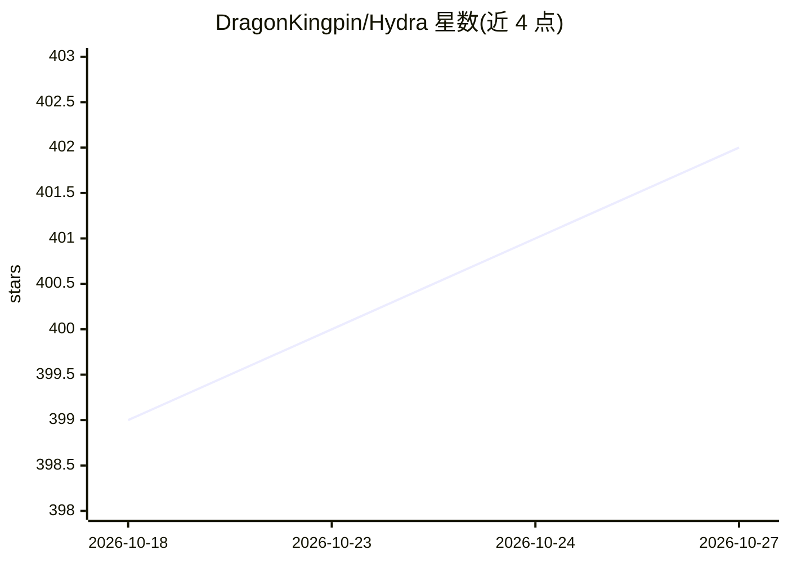

# DragonKingpin/Hydra

⭐ 402 · Java · MIT · 推送 2026-10-14 · [GitHub](https://github.com/DragonKingpin/Hydra) · [官网](https://www.nutsky.com) · 组织维护 · 中文 README

**面向个人的一站式分布式数据与AI调度基架系统**

Hydra 是由 DragonKing 及其团队用 Java 开发的分布式基架系统，面向个人构建大规模数据采集、任务调度、数据仓库与情报系统。提供分布式任务调度、进程并发、服务中心、S3 对象存储、卷系统、远程 Shell 与消息广播等能力；示例包含维基百科、IMDb 全站爬取与每日新闻采集等任务。使用 Maven 编译、需 JDK 11 以上，编译为 jar 包部署，配置文件默认位于 ./system/setup/ 目录；使用许可为 MIT。

## 筛选速览

| 维度 | 判定 | 备注 |
|---|---|---|
| AI 角色 | `ai-ecosystem` | LLM/agent 周边工具 |
| 许可风险 | `permissive` | MIT |
| 部署形态 | `None` |  |
| 模型依赖 | — | README 未给出锁定关系 |
| 硬件要求 | — | 无带数字的原话,不猜 |
| 安装摩擦 | `medium` | 含编译或系统依赖之一 |
| 成熟度 | — | 结构信号不足 |

## 能力要点

- 分布式任务调度、进程与大规模并发管理
- S3 对象存储、卷系统与分布式桶
- 分布式远程控制、Shell 与运维部署体系
- 内置爬虫（Heist）等流水线任务示例

## 适用场景

- 个人搭建大规模并行数据采集与情报系统
- 构建私有 PB 级数据仓库与知识库底座
- 以集群方式运行采集、分析、生产的流水线任务

## 场景标签

`网页抓取` · 领域:效率与自动化

## 证据(README 行号)

> L66: - Hydra 由 DragonKing 及其团队原创的分布式基架系统，
> L69: 一个人手握一个中台，控制一整个集群，你可以工业化地实现代码、情报、图片等流水线采集、分析、生产等，更多小秘密等亲发现。
> L102: 2. 分布式任务调度、分布式进程、大规模任务并发，应有尽有。

## 星数曲线

2026-10-18 399 → 2026-10-27 402（+3）

---
*卡片 v1 · prompt 1.4 · 生成 2026-10-21 · 置信度 mid · 依据 README sha `a50659926db9` · [字段定义](../../DATASET.md)*
