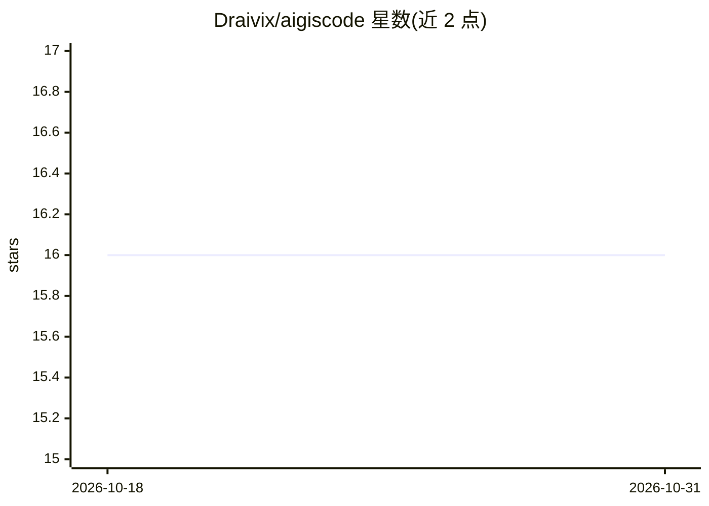

# Draivix/aigiscode

⭐ 16 · Rust · MIT · 推送 2026-10-21 · [GitHub](https://github.com/Draivix/aigiscode) · [官网](https://aigiscode.com) · 个人维护

**面向 AI agent 的全库静态分析 Rust CLI：构建语义图并输出机器可读产物**

用 Rust 实现的混合语言全代码库分析工具：解析源码、解析符号/引用、构建语义图/依赖图/证据图，产出死代码、架构评估、review surface、guard 决策等约二十种产物文件；`agent` 命令输出面向 AI 审查的有界上下文契约，`agent-run` 可经 codex-exec/responses-http/codex-sdk 等适配器执行 AI 审查，另支持 MCP over stdio、Kuzu 图查询（可选，需 CMake 与 C++20 编译器）以及 OpenGrep/Trivy/Grype/Gitleaks 外部分析器集成。安装方式为 cargo install 从源码构建。旧 Python 实现已从仓库移除。

## 筛选速览

| 维度 | 判定 | 备注 |
|---|---|---|
| AI 角色 | `ai-ecosystem` | LLM/agent 周边工具 |
| 许可风险 | `permissive` | MIT |
| 部署形态 | `library` | 以包/库形式分发 |
| 模型依赖 | — | README 未给出锁定关系 |
| 硬件要求 | — | 无带数字的原话,不猜 |
| 安装摩擦 | `medium` | 含编译或系统依赖之一 |
| 成熟度 | `idea` | |

## 能力要点

- 确定性分析流水线，产出语义图/依赖图/证据图等约 20 种产物
- `agent` 输出面向 AI 审查的有界 graph packets 契约，避免整库塞入 prompt
- `agent-run` 支持 codex-exec / responses-http / codex-sdk 三种适配器执行 AI 审查
- 支持 MCP over stdio 供其他工具/agent 消费，可集成 OpenGrep/Trivy/Grype/Gitleaks

## 适用场景

- 在 AI 代码审查前生成分层、有界的代码库上下文
- 定位真实运行时入口、结构中心文件与危险 API 的可达路径
- 对死代码/架构漂移做基于图的确定性检测与产物化审计

## 场景标签

`代码审查` · 领域:编码与开发

## 证据(README 行号)

> L7: Native Rust whole-codebase analysis for AI agents.
> L289: Use this when another tool or agent wants to consume AigisCode through MCP over

## 星数曲线

2026-10-18 16 → 2026-10-31 16（+0）

---
*卡片 v1 · prompt 1.4 · 生成 2026-10-30 · 置信度 high · 依据 README sha `fdb0b1047b69` · [字段定义](../../DATASET.md)*
