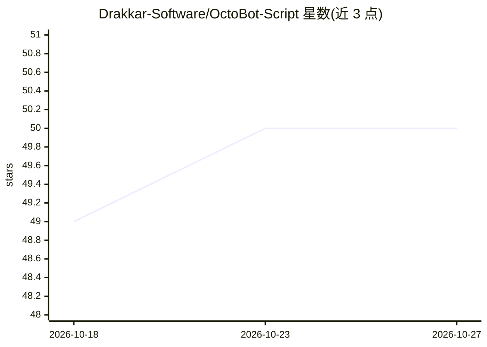

# Drakkar-Software/OctoBot-Script

⭐ 50 · TypeScript · GPL-3.0 · 推送 2026-10-22 · [GitHub](https://github.com/Drakkar-Software/OctoBot-Script) · [官网](https://www.octobot.cloud/guides/octobot-script?utm_source=github&utm_medium=dk&utm_campaign=regular_open_source_content&utm_content=octobot_script_project_description_link) · 组织维护

**OctoBot 出品的 Python 量化交易回测脚本框架**

OctoBot 的量化框架：用 Python 编写交易策略脚本，加载任意技术指标库（如 tulipy），对加密货币交易所数据执行回测并生成图文报告，定位类似 TradingView Pine Script 的脚本体验。以 pip 包形式发布，要求 Python 3.13，同时提供 Docker 镜像与社区渠道（Telegram/Discord）。README 自述处于 alpha 阶段。主题标签含机器学习、深度学习与强化学习，表明框架支持在策略中接入 ML 能力，但可见文档未展开 AI 细节。

## 筛选速览

| 维度 | 判定 | 备注 |
|---|---|---|
| AI 角色 | `ai-enhanced` | 去掉 AI 部分产品仍成立 |
| 许可风险 | `viral` | GPL-3.0 |
| 部署形态 | `library` | 以包/库形式分发 |
| 模型依赖 | — | README 未给出锁定关系 |
| 硬件要求 | — | 无带数字的原话,不猜 |
| 安装摩擦 | `low` | 无编译、无系统依赖或容器化 |
| 成熟度 | `idea` | |

## 能力要点

- Python 编写交易策略脚本并执行回测，生成报告
- 可搭配任意技术指标库（示例用 tulipy）
- pip 安装，要求 Python 3.13；提供 Docker 镜像

## 适用场景

- 用 Python 编写和回测量化交易策略
- 替代 TradingView Pine Script 做加密货币策略研究
- 生成回测报告对比策略表现

## 场景标签

`金融量化` · 领域:学习与行业

## 证据(README 行号)

> L12: ## OctoBot Script is the Quant framework by OctoBot
> L14: > OctoBot Script is in alpha version

## 星数曲线

2026-10-18 49 → 2026-10-27 50（+1）

---
*卡片 v1 · prompt 1.4 · 生成 2026-10-24 · 置信度 low · 依据 README sha `4e9b710782e2` · [字段定义](../../DATASET.md)*
