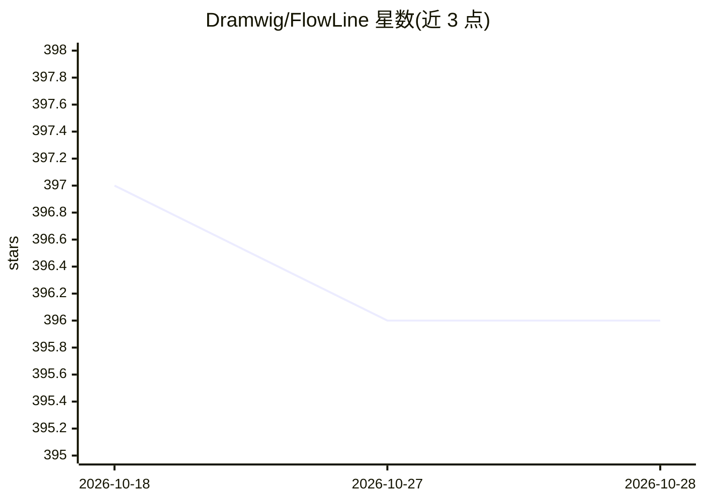

# Dramwig/FlowLine

⭐ 396 · JavaScript · Apache-2.0 · 推送 2026-01-12 · [GitHub](https://github.com/Dramwig/FlowLine) · 个人维护 · 中文 README

**GPU 资源监控与并发任务调度的自动化工具**

面向多任务实验与深度学习训练场景的 GPU 管理与命令流调度系统，提供 CLI 与 Web 两种交互方式。通过 Excel/CSV/JSON 任务表定义参数，结合用户自定义命令构造函数生成子进程命令；实时检测 GPU 显存与利用率，按优先级排序分配，CUDA OOM 等错误自动重新入队。支持任务优先级、失败重试、手动终止进程等动态调控。以 pip 包或源码安装，Web 后端为 Flask 应用。附实验室 GPU 占用场景的免责声明。

## 筛选速览

| 维度 | 判定 | 备注 |
|---|---|---|
| AI 角色 | `ai-ecosystem` | LLM/agent 周边工具 |
| 许可风险 | `permissive` | Apache-2.0 |
| 部署形态 | `library` | 以包/库形式分发 |
| 模型依赖 | — | README 未给出锁定关系 |
| 硬件要求 | — | 无带数字的原话,不猜 |
| 安装摩擦 | `medium` | 含编译或系统依赖之一 |
| 成熟度 | `idea` | |

## 能力要点

- 实时 GPU 状态监控与自定义优先级排序（user_cmp）
- CUDA Out of Memory 等非程序错误自动重新入队
- 通过 .xlsx/.csv/.json 任务表定义参数并自动映射为命令
- CLI 与 Web（Beta）双入口，支持任务队列动态干预

## 适用场景

- 多卡服务器上批量跑深度学习实验，自动等空闲 GPU 排队执行
- 参数网格搜索任务自动并发调度与失败重试
- 通过 Web 界面实时查看和终止 GPU 任务

## 场景标签

`MLOps` · 领域:训练与推理

## 证据(README 行号)

> L5: FlowLine 是一个用于 **GPU资源管理** 和 **并发指令流调度** 的自动化系统，支持 **命令行界面（CLI）** 和 **Web 图形界面（GUI）** 两种交互方式，适用于多任务实验、深度学习训练或高并发计算环境
> L11: 本系统的设计初衷在于替代传统的手动 GPU 监控与命令执行流程，从而提升实验效率。在传统方式下，用户需持续关注 GPU 的显存占用与利用率，并可能因 CUDA 内存不足（CUDA Out of Memory）而中断任务，需要手动启

## 星数曲线

2026-10-18 397 → 2026-10-28 396（-1）

---
*卡片 v1 · prompt 1.4 · 生成 2026-10-21 · 置信度 high · 依据 README sha `060a4b2216c3` · [字段定义](../../DATASET.md)*
