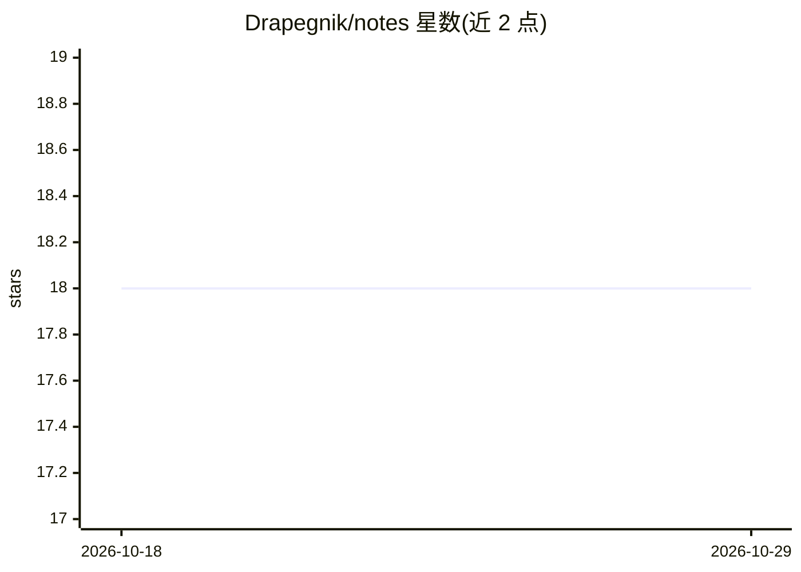

# Drapegnik/notes

⭐ 18 · 推送 2025-11-15 · [GitHub](https://github.com/Drapegnik/notes) · [官网](https://drapegnik.github.io/notes/) · 个人维护

**个人编程与机器学习笔记、文章与课程收藏集**

个人维护的 Markdown 笔记仓库，收录通用编程、函数式编程、macOS、工具、Git 等主题笔记，以及长文阅读清单与代码示例片段；内容通过 git grep 与关键词标签（如 #guide、#top）组织与检索。以纯文档仓库形式提供，无安装步骤，clone 后即可阅读。

## 筛选速览

| 维度 | 判定 | 备注 |
|---|---|---|
| AI 角色 | `ai-knowledge` | 知识聚合/清单类 |
| 许可风险 | `none` | — |
| 部署形态 | `None` |  |
| 模型依赖 | — | README 未给出锁定关系 |
| 硬件要求 | — | 无带数字的原话,不猜 |
| 安装摩擦 | `low` | 无编译、无系统依赖或容器化 |
| 成熟度 | — | 结构信号不足 |

## 能力要点

- 按主题拆分为多个 Markdown 笔记文件
- 支持 git grep 与关键词标签（#guide、#top）检索
- 包含代码片段与示例目录 exercises/

## 适用场景

- 查找他人整理的编程与工具学习笔记
- 浏览机器学习与计算机视觉相关的文章与课程收藏
- 参考代码片段与练习示例

## 场景标签

`精选清单` `教程课程` · 领域:学习与行业

## 证据(README 行号)

> L3: 📓 my notes, bookmarks, useful articles & courses `git.io/mynotes`
> L7: - `common.md` - common programming notes

## 星数曲线

2026-10-18 18 → 2026-10-29 18（+0）

---
*卡片 v1 · prompt 1.4 · 生成 2026-10-29 · 置信度 mid · 依据 README sha `a1b6404ef9ef` · [字段定义](../../DATASET.md)*
