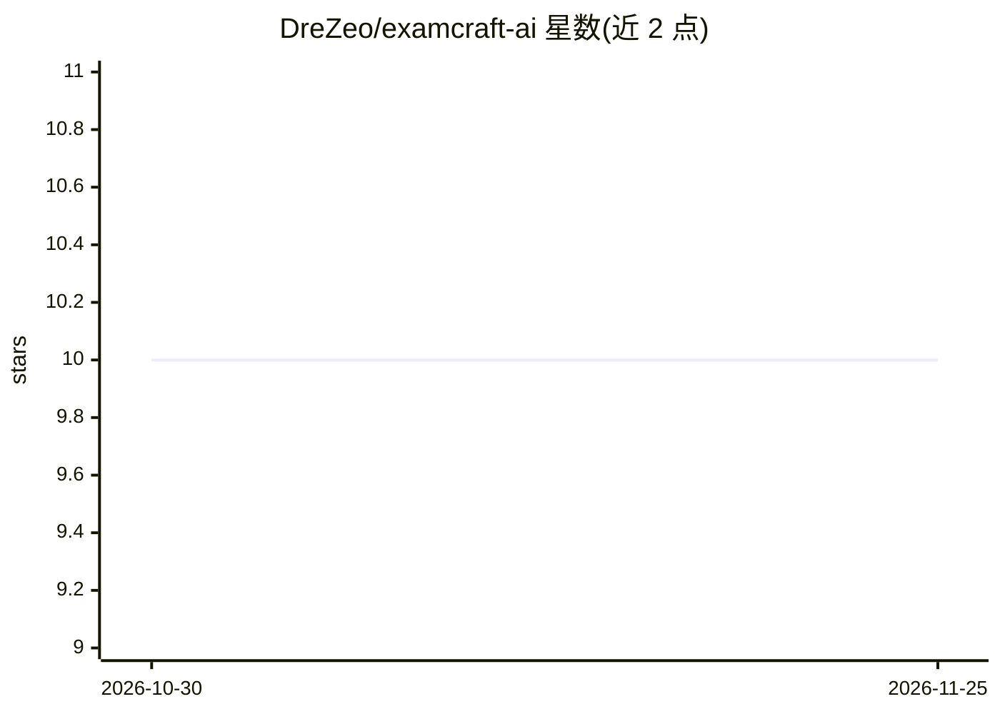

# DreZeo/examcraft-ai

⭐ 10 · TypeScript · MIT · 推送 2026-06-08 · [GitHub](https://github.com/DreZeo/examcraft-ai) · [官网](https://github.com/DreZeo/examcraft-ai/releases) · 个人维护 · 中文 README

**面向教师的 AI 试卷生成桌面试卷工作台**

基于 Tauri 的本地优先桌面试卷工具，面向教师、培训者和教育内容创作者。用户用自然语言描述需求，应用采用两阶段流程：先由模型分析确认，再生成结构化题目 JSON，经 Zod 与题型策略校验后进入试卷。提供接近 Word 的排版（纸张、字号、页眉页脚）、实时分页预览、教师版/学生版双视图、JSON/Markdown 导出与打印。模型通过 OpenAI 兼容端点配置，联网搜索可选接入 Tavily/Exa/Firecrawl；数据存本地目录，API Key 存系统钥匙串。构建需 Node.js 与 Rust 环境。

## 筛选速览

| 维度 | 判定 | 备注 |
|---|---|---|
| AI 角色 | `ai-native` | 本体是模型或模型工具 |
| 许可风险 | `permissive` | MIT |
| 部署形态 | `library` | 以包/库形式分发 |
| 模型依赖 | local-ok | 支持本地模型 |
| 硬件要求 | — | 无带数字的原话,不猜 |
| 安装摩擦 | `low` | 无编译、无系统依赖或容器化 |
| 成熟度 | — | 结构信号不足 |

## 能力要点

- 两阶段生成：先分析确认再结构化输出，含校验与自动自我修正
- 支持单选/多选/判断/填空/简答/论述/计算七种题型，内容支持 KaTeX 公式与代码高亮
- 接近 Word 的试卷排版与真实纸张分页预览，教师版/学生版同源视图
- 本地优先存储，API Key 存入系统钥匙串

## 适用场景

- 给班级按学科、年级、难度快速出一套试卷
- 出计算机、数学等含代码和公式的理科试卷
- 排版打印教师版和学生版两套卷子
- 接入本地模型端点离线出题

## 场景标签

`AI 写作` · 领域:内容生成

## 证据(README 行号)

> L7:  一个本地优先的桌面试卷工作台，用 AI 生成题目，用接近 Word 的方式排版、预览、打印和导出。
> L13: 智卷工坊是一款面向教师、培训者和教育内容创作者的 Tauri 桌面应用。你可以用自然语言描述试卷需求，应用会让 AI 先分析并确认理解，再生成结构化题目数据；题目 JSON 经过严格校验后，才能进入试卷，并实时渲染为分页的纸张预览

## 星数曲线

2026-10-30 10 → 2026-11-25 10（+0）

---
*卡片 v1 · prompt 1.4 · 生成 2026-11-20 · 置信度 high · 依据 README sha `c639b2acf804` · [字段定义](../../DATASET.md)*
