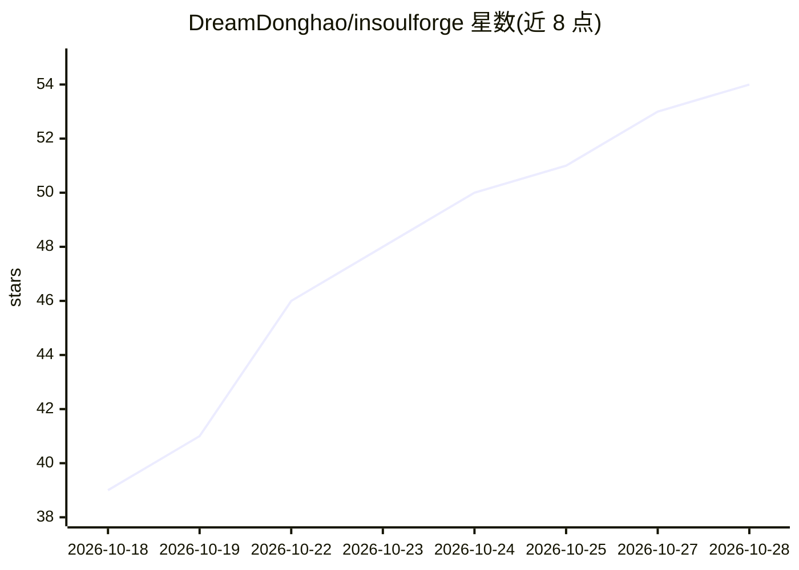

# DreamDonghao/insoulforge

⭐ 54 · C++ · AGPL-3.0 · 推送 2026-10-26 · [GitHub](https://github.com/DreamDonghao/insoulforge) · 个人维护 · 中文 README

**QQ 群聊 AI 机器人后端：智能回复、记忆与好感度**

基于 C++23 与 Agent 架构的 OneBot 协议 QQ 聊天机器人后端，本体不含聊天平台协议实现，需配合 NapCat 等 OneBot 实现使用。功能包括 Jev/Router/Executor 分层决策与回复生成、按 QQ 归属的长期人物记忆与好感度、跨会话消息共享、图片识别与生成、Lua 脚本自定义工具、HTTP MCP 接入及 Web 管理后台。LLM 各环节均使用 OpenAI 兼容接口分别配置，Embedding 可选。以 Docker 镜像（amd64/arm64）或源码方式部署，端口 7778。

## 筛选速览

| 维度 | 判定 | 备注 |
|---|---|---|
| AI 角色 | `ai-native` | 本体是模型或模型工具 |
| 许可风险 | `viral` | AGPL-3.0 |
| 部署形态 | `self-host` | docker 或自建部署 |
| 模型依赖 | — | README 未给出锁定关系 |
| 硬件要求 | — | 无带数字的原话,不猜 |
| 安装摩擦 | `low` | 无编译、无系统依赖或容器化 |
| 成熟度 | — | 结构信号不足 |

## 能力要点

- Jev 结构化决策路由 + Router 兜底 + Executor 生成的分层回复架构
- 按 QQ 归属的长期人物记忆、每日档案整理与好感度系统，可选 Embedding 语义召回
- Lua 脚本自定义工具（进程内运行、异步 HTTP、JSON 导入导出）与 HTTP MCP 工具接入
- 跨会话消息共享、图片识别/生成及 Web 管理后台

## 适用场景

- 为 QQ 群搭建带长期记忆与人设的 AI 聊天机器人
- 通过 Lua 脚本和 MCP 扩展机器人能力（搜索、天气、网页读取等）
- 在 Web 后台管理多个群的会话、提示词与模型配置

## 场景标签

`聊天机器人` `Agent 记忆` · 领域:Agent 开发

## 证据(README 行号)

> L3: 一个基于 Agent 架构的智能 QQ 群聊机器人后端。
> L13: - **Jev 决策与智能回复** - 可选用 Jev 专用结构化决策模型快速判断是否回复，减少高频判断对聊天模型的依赖；低置信度或请求失败时由 Router LLM 兜底，再由 Executor 生成回复与调用工具
> L14: - **智能记忆** - 自动提取群友喜好与重要事件，并根据互动更新好感度；可选配 Embedding 模型，按语义相似度召回长期记忆，减少对完整聊天记录的依赖

## 星数曲线

2026-10-18 39 → 2026-10-28 54（+15）

---
*卡片 v1 · prompt 1.4 · 生成 2026-10-24 · 置信度 high · 依据 README sha `c4dbcdcdea07` · [字段定义](../../DATASET.md)*
