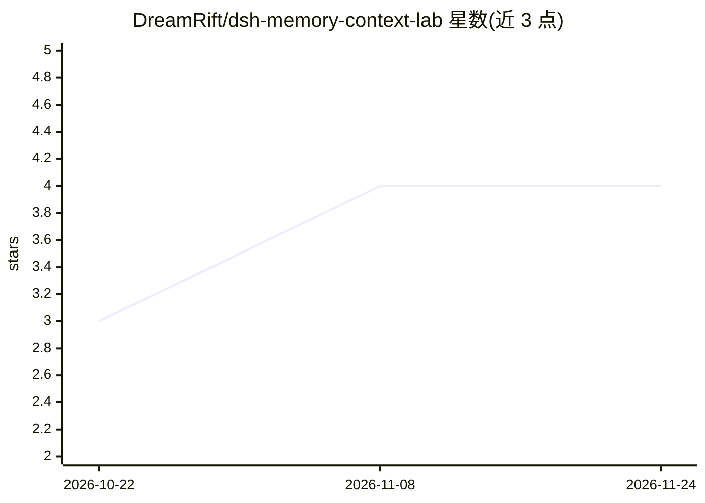

# DreamRift/dsh-memory-context-lab

⭐ 4 · JavaScript · MIT · 推送 2026-11-07 · [GitHub](https://github.com/DreamRift/dsh-memory-context-lab) · 个人维护 · 中文 README

**DSH 会话的上下文记忆管理插件：检索回注历史要点**

面向 DSH Desktop 的插件（版本 0.15.4）：把会话中的用户消息、助手消息与工具调用结果异步摄入本会话的隔离影子库，每步以人类输入为查询词做本地词法检索，将命中要点组成的回注包追加到当前步上下文，回注包上限 4000 字符。提供 /memory-lab 命令查看位点与健康状态、composer 弹层做本对话级开关，敏感凭据在摄入前脱敏，遗忘操作保留审计行。可选启用 Python 环境的 T2 隔离 MCP 检索后端，失败时回退本地索引。仅支持 DSH Desktop 0.2.2-rc.1 宿主。

## 筛选速览

| 维度 | 判定 | 备注 |
|---|---|---|
| AI 角色 | `ai-ecosystem` | LLM/agent 周边工具 |
| 许可风险 | `permissive` | MIT |
| 部署形态 | `None` |  |
| 模型依赖 | — | README 未给出锁定关系 |
| 硬件要求 | — | 无带数字的原话,不猜 |
| 安装摩擦 | `low` | 无编译、无系统依赖或容器化 |
| 成熟度 | — | 结构信号不足 |

## 能力要点

- 按步/按轮归档，回注包硬顶 4000 字符以维持前缀缓存
- 本地 Node store + 词法索引为默认检索后端，T2 隔离 MCP 可选
- 摄入前脱敏凭据字段，回注正文标注来源防注入
- composer chip 弹层提供本对话级启用/条数/模式控制

## 适用场景

- 长对话 agent 会话中回注历史要点而不破坏缓存前缀
- 按会话隔离管理记忆数据并支持遗忘/撤销语义
- 敏感凭据需要摄入前自动脱敏的场景

## 场景标签

`Agent 记忆` · 领域:Agent 开发

## 证据(README 行号)

> L3: 按 **DSH 会话** 启用的上下文管理插件（**v3 单引擎**）：把会话事件摄入本会话的隔离影子库，每一步按当前用户输入检索历史、把命中要点回注到本步上下文；composer chip 弹层只放**本对话控制**，底层参数在插
> L13: - **摄入**：每个 `agent/pre-step` 把本会话新增的 `user/message`、`assistant/message`、`tool/call`、`tool/result` 归一化写入隔离影子库（后台异步、单
> L14: - **回注**：以**人类本回合输入**为查询词检索影子库，命中足够时把「命中 ID + 相关度 + 定长首部切片」组成有上界的回注包，追加到本步消息批次末尾（每回合同类只注入一次）；

## 星数曲线

2026-10-22 3 → 2026-11-24 4（+1）

---
*卡片 v1 · prompt 1.4 · 生成 2026-11-21 · 置信度 mid · 依据 README sha `b1777139ead4` · [字段定义](../../DATASET.md)*
