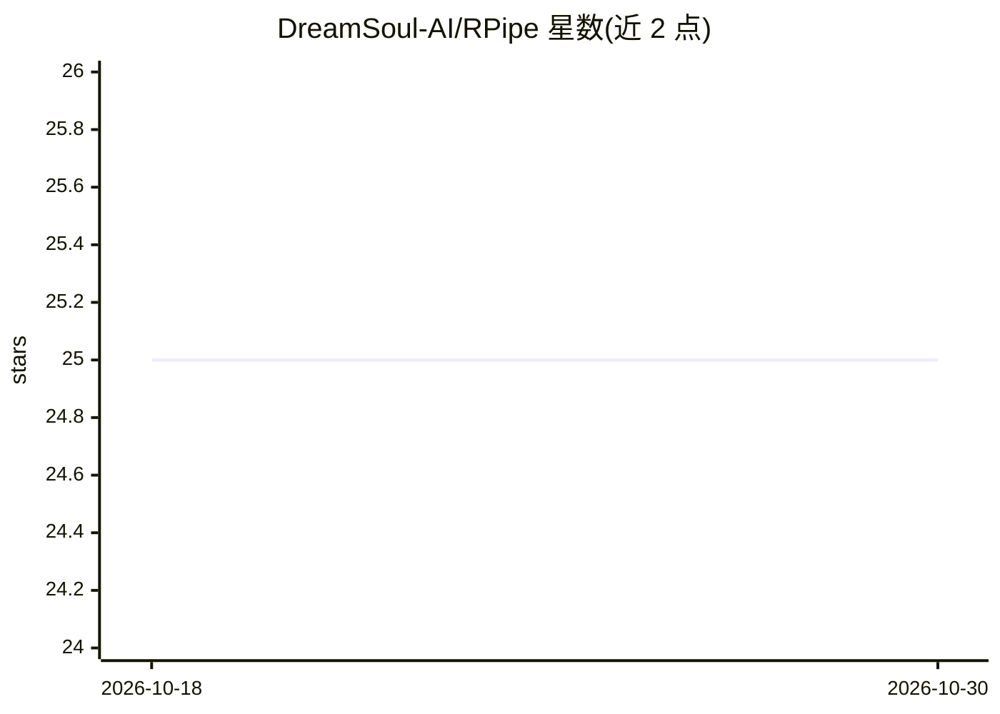

# DreamSoul-AI/RPipe

⭐ 25 · Python · MIT · 推送 2026-10-27 · [GitHub](https://github.com/DreamSoul-AI/RPipe) · 个人维护 · 中文 README

**研究实验代码架构与执行模板：YAML 声明实验并自动展开运行**

面向深度学习研究项目的代码架构与执行模板：以 Study/Experiment/Run 三层组织研究，用 YAML 声明实验因素（axes）与 seed，由 make 展开成配置、index 与调度计划，launch 执行固定阶段链并跨 seed 聚合，保存配置、结果、日志与 checkpoint。支持源码模板接入、跨 Study 不可变输入共享、原生 PyTorch / Hugging Face Trainer 通路、checkpoint/resume 与跨 seed 汇总。接入方式为源码复制到下游项目 src/，不作为 pip 外部依赖；要求 Python 3.10+，提供 Data/Model/Algorithm Registry 注册扩展接口。

## 筛选速览

| 维度 | 判定 | 备注 |
|---|---|---|
| AI 角色 | `ai-ecosystem` | LLM/agent 周边工具 |
| 许可风险 | `permissive` | MIT |
| 部署形态 | `desktop` | 安装包/桌面程序 |
| 模型依赖 | — | README 未给出锁定关系 |
| 硬件要求 | — | 无带数字的原话,不猜 |
| 安装摩擦 | `medium` | 含编译或系统依赖之一 |
| 成熟度 | — | 结构信号不足 |

## 能力要点

- Study/Experiment/Run 三层实验组织与 YAML axes×seeds 展开
- make/launch/status/logs/report 命令行流程与跨 seed mean/std 聚合
- 源码模板接入方式：复制 src/rpipe/ 而非 pip 依赖，freeze 拒绝来源变化
- Data/Model/Algorithm Registry 注册自定义数据、模型与计算

## 适用场景

- 为自己的深度学习研究项目搭建可复现的实验执行框架
- 一次声明多组超参/因素与多 seed，自动展开并汇总结果
- 管理实验配置、checkpoint、日志与跨 seed 统计到同一 Study

## 场景标签

`MLOps` · 领域:训练与推理

## 证据(README 行号)

> L3: RPipe（Research Pipeline）是研究项目的代码架构与执行模板，本仓库的参考实现使用 Python 包名 `rpipe`。用 YAML 声明实验因素与 seed，展开并运行实验，再将配置、结果、日志、checkpoi
> L5: 当前模板版本为 **0.4.1**，提供源码模板接入、跨 Study 不可变输入共享、原生 PyTorch / Hugging Face Trainer 通路、checkpoint/resume、运行日志与跨 seed 汇总。项目级

## 星数曲线

2026-10-18 25 → 2026-10-30 25（+0）

---
*卡片 v1 · prompt 1.4 · 生成 2026-10-27 · 置信度 high · 依据 README sha `ec4df9dc9536` · [字段定义](../../DATASET.md)*
