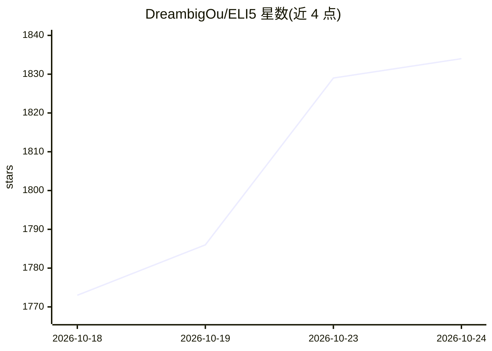

# DreambigOu/ELI5

⭐ 1,834 · Python · MIT · 推送 2026-03-18 · [GitHub](https://github.com/DreambigOu/ELI5) · [官网](https://andrewou.pages.dev/posts/building-an-eli5-skill-for-claude/) · 个人维护

**Claude Code 技能：让 Claude 按受众调整解释风格**

面向 Claude Code 的技能（skill）：从提示中检测目标受众（按年龄、年级、职位、关系划分），并据此调整词汇、类比、语气、深度与框架，使解释适配对象，如给经理、5 岁儿童、工程师等不同人群。安装方式为 git clone 后复制到 ~/.claude/skills/eli5。附带评测系统：用 Python 脚本对每个提示在有/无技能两种情况下各运行一次，由 Claude 自动按断言评分并输出通过率对比，当前结果为 83.3% 对 41.6%。

## 筛选速览

| 维度 | 判定 | 备注 |
|---|---|---|
| AI 角色 | `ai-native` | 本体是模型或模型工具 |
| 许可风险 | `permissive` | MIT |
| 部署形态 | `None` |  |
| 模型依赖 | — | README 未给出锁定关系 |
| 硬件要求 | — | 无带数字的原话,不猜 |
| 安装摩擦 | `low` | 无编译、无系统依赖或容器化 |
| 成熟度 | — | 结构信号不足 |

## 能力要点

- 按年龄/年级/职位/关系检测受众并调整词汇、类比、语气、深度与框架
- 评测脚本对每个测试用例跑有/无技能两次并自动评分对比
- 评测结果按迭代保存于 eli5-workspace 目录，附评分证据文件

## 适用场景

- 把技术概念解释给非技术背景的同事或家人
- 让 Claude 按不同受众（儿童/经理/设计师）定制解释风格
- 对 Claude Code 技能做带基线对比的自动评测

## 场景标签

`提示工程` · 领域:Agent 开发

## 证据(README 行号)

> L3: > A Claude Code skill that explains anything to anyone — kids, managers, engineers, parents. It adapts tone, vocabul

## 星数曲线

2026-10-18 1,773 → 2026-10-24 1,834（+61）

---
*卡片 v1 · prompt 1.4 · 生成 2026-10-21 · 置信度 high · 依据 README sha `19c8aa31b9f5` · [字段定义](../../DATASET.md)*
