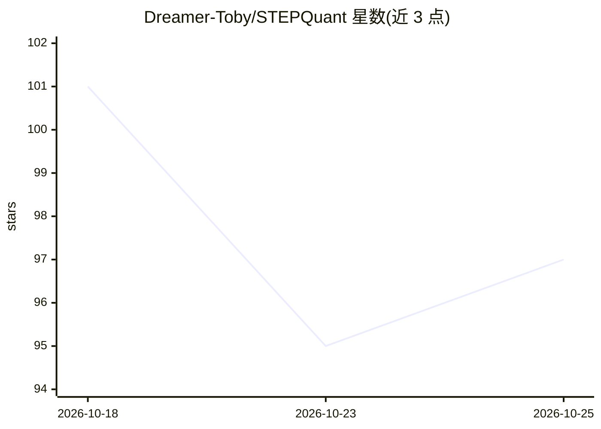

# Dreamer-Toby/STEPQuant

⭐ 98 · Python · 推送 2026-10-23 · [GitHub](https://github.com/Dreamer-Toby/STEPQuant) · [官网](https://arxiv.org/abs/2609.38169) · 组织维护

**Delta-rule 模型循环状态的后训练量化压缩方法（论文官方代码）**

STEPQuant 是针对 Delta-rule 线性注意力模型（Qwen、Kimi-Linear 等）持久循环状态的后训练量化方法：按状态单元的误差寿命分配比特数（长寿命误差获得更多位、高风险单元保留 FP16），并分别缩放键行与值列；校准一次后由打包状态内核与异步写回保持推理效率。论文报告在 Qwen/Kimi 上压缩循环状态内存约 5×、降低总内存 68.7%/53.7%。以研究代码形式提供，依赖 SGLang 0.5.12、PyTorch 2.11.0、Triton 3.7.1，需 CUDA 与多 GPU。

## 筛选速览

| 维度 | 判定 | 备注 |
|---|---|---|
| AI 角色 | `ai-ecosystem` | LLM/agent 周边工具 |
| 许可风险 | `none` | — |
| 部署形态 | `None` |  |
| 模型依赖 | — | README 未给出锁定关系 |
| 硬件要求 | — | 无带数字的原话,不猜 |
| 安装摩擦 | `medium` | 含编译或系统依赖之一 |
| 成熟度 | — | 结构信号不足 |

## 能力要点

- 寿命感知的比特分配：长寿命误差单元获得更多位、高风险单元保留 FP16
- 键行-值列双轴拟合分别缩放
- 论文报告循环状态内存压缩约 5×，Qwen/Kimi 总内存降低 68.7%/53.7%
- 校准一次后由打包状态内核与异步写回执行推理

## 适用场景

- 为 Qwen/Kimi-Linear 等 Delta-rule 模型降低推理时的状态内存占用
- 在低比特（4/6-bit）量化下保持长生成任务的精度
- 复现论文中七个长生成任务的评测结果

## 场景标签

`模型量化` · 领域:训练与推理

## 证据(README 行号)

> L22: **STEPQuant** compresses the persistent recurrent states of Delta-rule models. It decides **when** errors will last
> L52: Run from the repository root. The tested stack uses **SGLang 0.5.12**, **PyTorch 2.11.0**, and **Triton 3.7.1**. Yo

## 星数曲线

2026-10-18 101 → 2026-10-25 97（-4）

---
*卡片 v1 · prompt 1.4 · 生成 2026-10-23 · 置信度 high · 依据 README sha `a2c7972aac01` · [字段定义](../../DATASET.md)*
