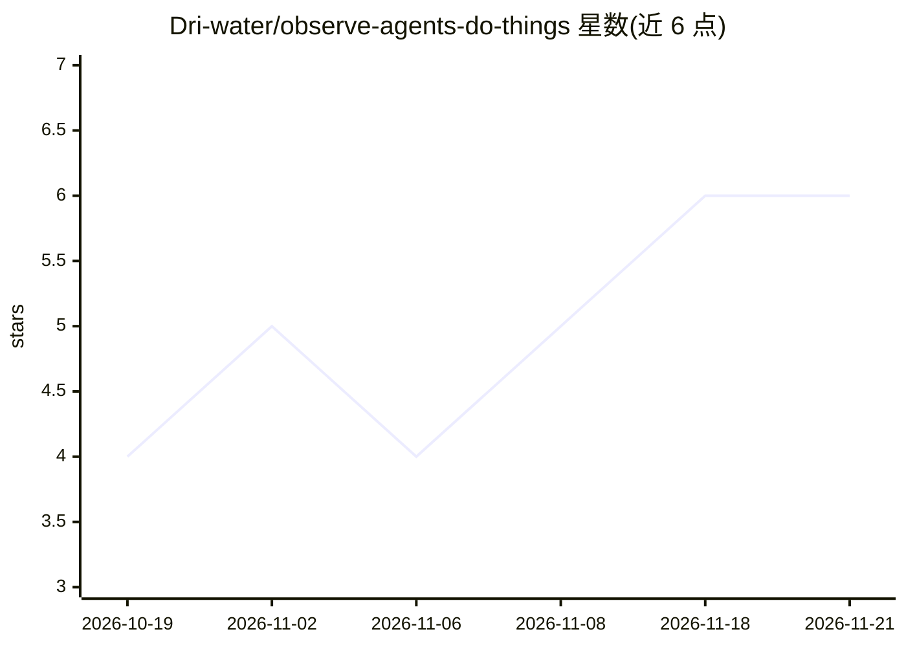

# Dri-water/observe-agents-do-things

⭐ — · [GitHub]() · 个人维护

**实时可视化观察 Claude Code 与 Codex agent 工作的只读仪表盘**

一个旁路运行的实时仪表盘：不修改 agent 本体（无 hooks、无包装器、无 API key），只读取 Claude Code 与 Codex 已写出的 transcript 文件，归一化为统一事件流，通过 SSE 提供给可插拔的前端。内置三个可视化（Mission Control、Agent Office、The Court），支持子 agent 树重建、会话状态（working/waiting/idle）提示、多会话并排、大文件毫秒级读取、历史回放与隐私脱敏；并提供 @oadt/protocol 与 client/react 包供自建前端。需 Node.js 20.11+，可通过 npx、全局安装、源码或 Docker 运行。

## 筛选速览

| 维度 | 判定 | 备注 |
|---|---|---|
| AI 角色 | `ai-ecosystem` | LLM/agent 周边工具 |
| 许可风险 | `permissive` | — |
| 部署形态 | `self-host` | docker 或自建部署 |
| 模型依赖 | — | README 未给出锁定关系 |
| 硬件要求 | — | 无带数字的原话,不猜 |
| 安装摩擦 | `low` | 无编译、无系统依赖或容器化 |
| 成熟度 | — | 结构信号不足 |

## 能力要点

- 零侵入：只读取 transcript 文件，无 hooks、无设置修改、无 API key
- 核心无运行时依赖，13 种事件协议 + 纯函数 reducer，前端可插拔
- 重建 Claude Code 与 Codex 的子 agent 树，会话详情含工具调用、diff、token 与成本
- 本地回环绑定、可选内容脱敏与 bearer token 鉴权

## 适用场景

- 同时跑多个 coding agent 会话时，集中查看谁在等我审批
- 不改动现有 Claude Code / Codex 使用方式，为它们加实时可视化
- 基于事件协议自建终端仪表盘或通知器等自定义前端

## 场景标签

`LLM 可观测性` · 领域:评测与运维

## 证据(README 行号)

> L20: Keep using Claude Code and Codex exactly as you do now: the CLI, the IDE extensions or the desktop apps. `oadt` sit
> L98: - **Bring your own agent.** `POST /api/ingest` accepts protocol events, so your own agent can show up next to Claud
> L121: The whole contract is in `@oadt/protocol`: 13 event kinds and one reducer.

## 星数曲线

2026-10-19 4 → 2026-11-21 6（+2）

---
*卡片 v1 · prompt 1.4 · 生成 2026-11-20 · 置信度 high · 依据 README sha `2f7c10540b9b` · [字段定义](../../DATASET.md)*
