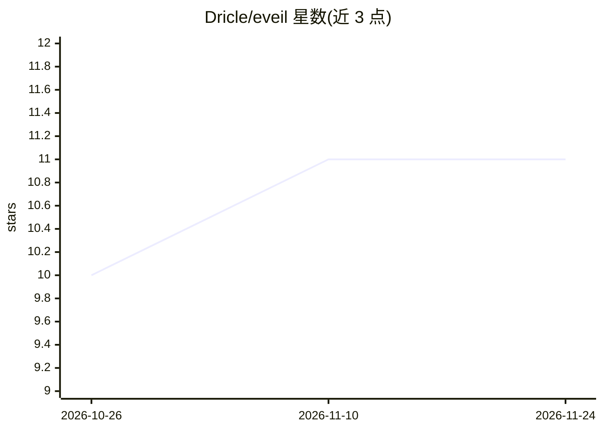

# Dricle/eveil

⭐ 11 · PHP · AGPL-3.0 · 推送 2026-11-22 · [GitHub](https://github.com/Dricle/eveil) · [官网](https://eveil.cloud) · 个人维护

**自托管的 B2B 冷触达营销 agent：读产品站、找线索、写序列并经自有邮箱发送**

面向中小企业/独立开发者的自托管营销自动化应用（PHP 8.4/Laravel，AGPL-3.0，Docker 部署）：输入产品网址后，它分析站点并读取 GitHub 仓库，用两个内置搜索引擎加 OpenStreetMap 自行发现公司与联系人并打分，生成邮件序列，经用户自己的 SMTP 邮箱发送、经 IMAP 读取并串联回复；同时生成 LinkedIn/X/Bluesky/Instagram 帖子、Reddit 回复草稿、SEO 文章与产品短视频（Chromium+ffmpeg 本地渲染）。带聊天助手、API、MCP server 与 CRM webhook；云版按量计费，功能与自托管一致。

## 筛选速览

| 维度 | 判定 | 备注 |
|---|---|---|
| AI 角色 | `ai-native` | 本体是模型或模型工具 |
| 许可风险 | `viral` | AGPL-3.0 |
| 部署形态 | `self-host` | docker 或自建部署 |
| 模型依赖 | — | README 未给出锁定关系 |
| 硬件要求 | — | 无带数字的原话,不猜 |
| 安装摩擦 | `low` | 无编译、无系统依赖或容器化 |
| 成熟度 | — | 结构信号不足 |

## 能力要点

- 自带两个搜索引擎加 OpenStreetMap 做线索发现，不需付费数据 API 即可启动
- 从用户自有邮箱经 SMTP/IMAP 发送并读取回复，按 Message-ID 串联线程
- 帖子、SEO 文章与短视频生成（含导演 agent、本地渲染配音配乐）
- 提供 API、MCP server 与面向 HubSpot/Pipedrive 的双向 webhook

## 适用场景

- B2B 团队自动发现目标公司并从自有邮箱发冷邮件
- 为 LinkedIn/X/Bluesky/Instagram 排队生成待审核的社媒帖子
- 为博客生成基于真实调研的 SEO 文章
- 通过 n8n/CRM webhook 把回复与商机状态接入现有销售流程

## 场景标签

`工作流自动化` `视频生成` `AI 写作` · 领域:效率与自动化

## 证据(README 行号)

> L12: Enter your product's website. Eveil reads it, works out who buys it, then
> L60: - **Finds the companies and the people, on its own.** Segments, search terms,
> L112: - **Self-hosted and AGPL-3.0.** Four containers, five minutes, your data never

## 星数曲线

2026-10-26 10 → 2026-11-24 11（+1）

---
*卡片 v1 · prompt 1.4 · 生成 2026-11-19 · 置信度 high · 依据 README sha `5c038c8a717a` · [字段定义](../../DATASET.md)*
