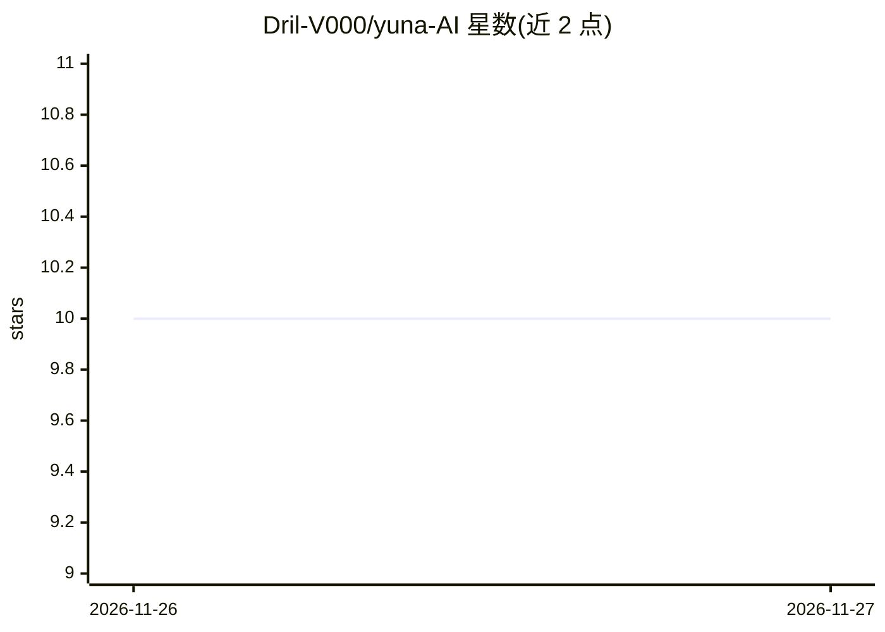

# Dril-V000/yuna-AI

⭐ 10 · NOASSERTION · 推送 2026-11-26 · [GitHub](https://github.com/Dril-V000/yuna-AI) · [官网](https://yunaai.online/) · 个人维护

**Windows 桌面 AI 伴侣：语音对话、Live2D 形象与本地模型**

面向 Windows 桌面的 AI 伴侣应用，将语音对话、带表情与口型同步的 Live2D 角色、角色级对话上下文与可定制人设整合在一个应用中。用户可选择通过 Ollama 在本地运行模型，或使用自有 API 配置接入云端提供商；内置网页搜索、打开链接、保存笔记等聊天工具，并可自定义角色、提示词、背景与兼容的 Live2D 模型。通过 Releases 页面下载 Windows 安装包安装，本地模型使用情况取决于用户硬件。

## 筛选速览

| 维度 | 判定 | 备注 |
|---|---|---|
| AI 角色 | `ai-native` | 本体是模型或模型工具 |
| 许可风险 | `none` | NOASSERTION |
| 部署形态 | `desktop` | 安装包/桌面程序 |
| 模型依赖 | local-ok | 支持本地模型 |
| 硬件要求 | — | 无带数字的原话,不猜 |
| 安装摩擦 | `low` | 无编译、无系统依赖或容器化 |
| 成熟度 | — | 结构信号不足 |

## 能力要点

- 语音对话：说话并听取语音回复
- Live2D 角色带表情与口型同步动画
- 本地模型（Ollama）或云端提供商可选连接
- 可定制角色、提示词、背景与 Live2D 模型

## 适用场景

- 在本机运行本地模型进行语音陪伴对话
- 定制个性化 Live2D 角色与人设
- 让伴侣角色帮助搜索网页、保存笔记

## 场景标签

`聊天机器人` `语音 Agent` · 领域:对话与助手

## 证据(README 行号)

> L3: A Windows desktop AI companion that brings voice conversations, expressive Live2D characters, and customizable perso
> L18: - 🤖 **Your choice of AI** — connect a local model through Ollama or use a supported cloud provider.
> L36: - **Local models (Ollama):** run a supported model on your own computer. Performance depends on your hardware and t

## 星数曲线

2026-11-26 10 → 2026-11-27 10（+0）

---
*卡片 v1 · prompt 1.4 · 生成 2026-11-26 · 置信度 high · 依据 README sha `63dd7f371e97` · [字段定义](../../DATASET.md)*
