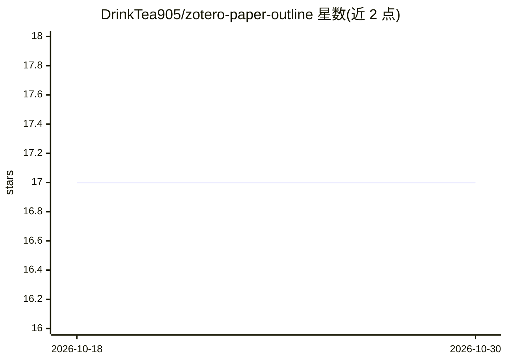

# DrinkTea905/zotero-paper-outline

⭐ 17 · JavaScript · MIT · 推送 2026-09-04 · [GitHub](https://github.com/DrinkTea905/zotero-paper-outline) · 个人维护 · 中文 README

**Zotero 插件：自动读论文生成中文总结与可跳转层级目录**

面向 Zotero 7/8/9 用户的论文阅读插件：通读 PDF 生成结构化中文整篇总结（存为子笔记）与带页码的层级目录（显示在阅读器大纲栏，可点击跳转、自动高亮），新文献入库后自动排队处理。扫描版 PDF 可经 MinerU 识别文字后继续。支持 DeepSeek、OpenAI 兼容接口、Ollama 本地运行等 9 类服务商，模型栏可留空自动查询适配；生成前可测试 AI 连接。另提供多篇 PDF 复制与中文空格本地清理等实用功能，以 .xpi 插件包安装。

## 筛选速览

| 维度 | 判定 | 备注 |
|---|---|---|
| AI 角色 | `ai-native` | 本体是模型或模型工具 |
| 许可风险 | `permissive` | MIT |
| 部署形态 | `None` |  |
| 模型依赖 | local-ok | 支持本地模型 |
| 硬件要求 | — | 无带数字的原话,不猜 |
| 安装摩擦 | `low` | 无编译、无系统依赖或容器化 |
| 成熟度 | — | 结构信号不足 |

## 能力要点

- 生成整篇中文总结与带页码可跳转的层级目录
- 新文献入库自动排队处理，已有结果自动跳过
- 支持 DeepSeek/OpenAI 兼容/Ollama 等 9 类服务商，模型自动适配
- 扫描 PDF 经 MinerU 识别后继续处理，Token 存本机

## 适用场景

- 新论文入库后自动得到中文总结和可导航目录
- 阅读长论文时快速定位章节并高亮跟踪
- 扫描版 PDF 也能生成文字总结与目录

## 场景标签

`科研工具` · 领域:学习与行业

## 证据(README 行号)

> L5:  让 Zotero 自动读论文：生成整篇总结与可跳转的层级目录。
> L27: - 通读论文并生成结构化的中文整篇总结；
> L57: Paper Outline 会通读全文，生成便于回顾和引用的结构化中文总结，并保存为当前文献的 Zotero 子笔记。

## 星数曲线

2026-10-18 17 → 2026-10-30 17（+0）

---
*卡片 v1 · prompt 1.4 · 生成 2026-10-30 · 置信度 high · 依据 README sha `14de885f7d34` · [字段定义](../../DATASET.md)*
