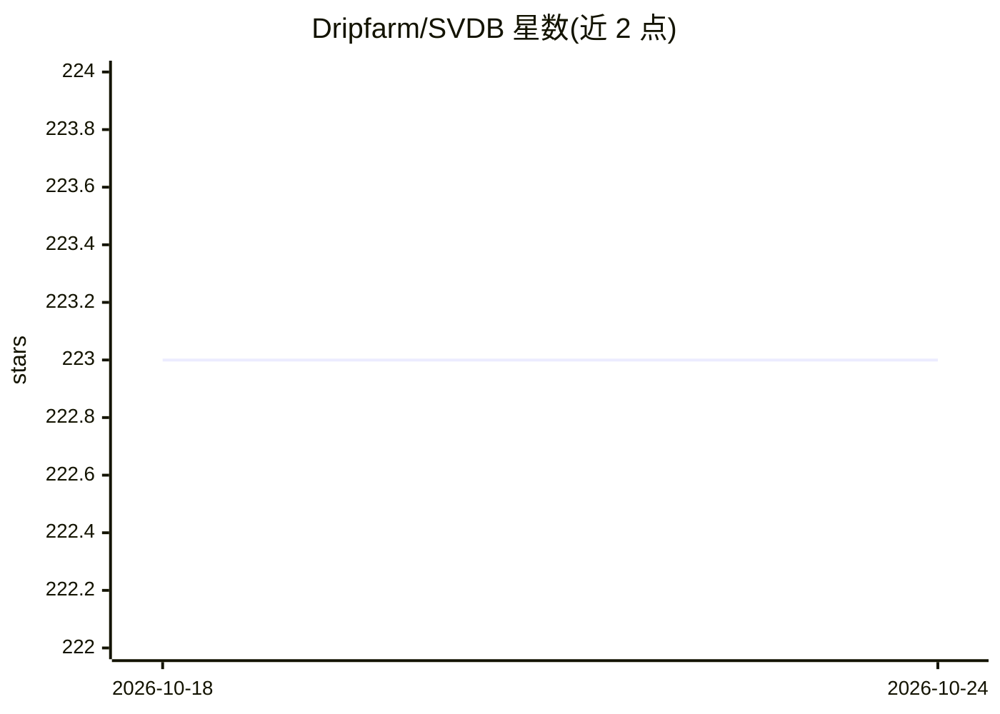

# Dripfarm/SVDB

⭐ 223 · Swift · MIT · 推送 2025-12-07 · [GitHub](https://github.com/Dripfarm/SVDB) · 个人维护

**Swift 本地向量数据库，用于 iOS 端上语义检索**

面向 Swift 应用的本地端上向量数据库库，提供 collection 创建、添加文档（文本+嵌入向量）与向量相似度搜索的 API。嵌入需自行生成，README 示例展示用 Swift OpenAI 包或系统 NLEmbeddings 产生向量后存入。通过 Swift Package Manager 集成到 Xcode 项目。作者在 Todo 中表示计划简化文档添加与嵌入流程。提供 Demo 链接。

## 筛选速览

| 维度 | 判定 | 备注 |
|---|---|---|
| AI 角色 | `ai-ecosystem` | LLM/agent 周边工具 |
| 许可风险 | `permissive` | MIT |
| 部署形态 | `None` |  |
| 模型依赖 | — | README 未给出锁定关系 |
| 硬件要求 | — | 无带数字的原话,不猜 |
| 安装摩擦 | `low` | 无编译、无系统依赖或容器化 |
| 成熟度 | — | 结构信号不足 |

## 能力要点

- 本地端上运行，无需服务器的向量存储与搜索
- collection 组织文档并支持向量相似度查询
- 兼容任意来源的嵌入向量（OpenAI 包、NLEmbeddings 均有示例）
- Swift Package Manager 一行依赖集成

## 适用场景

- 在 iOS/macOS 应用中做本地语义搜索
- 端上存储文档嵌入并按相似度检索，无需后端
- 构建离线可用的智能功能原型

## 场景标签

`向量数据库` · 领域:知识与检索

## 证据(README 行号)

> L3: A new fast local on-device vector database for Swift Apps.
> L62: let results = animalCollection.search(query: dogEmedding)

## 星数曲线

2026-10-18 223 → 2026-10-24 223（+0）

---
*卡片 v1 · prompt 1.4 · 生成 2026-10-22 · 置信度 high · 依据 README sha `605d3e03dcf5` · [字段定义](../../DATASET.md)*
