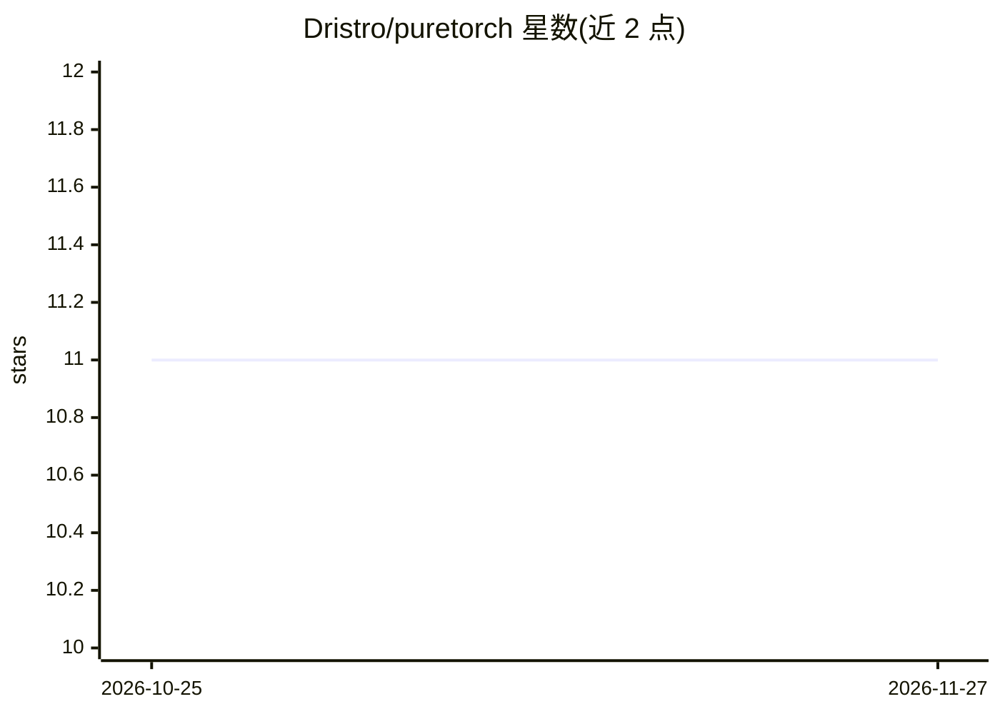

# Dristro/puretorch

⭐ 11 · Python · MIT · 推送 2026-05-19 · [GitHub](https://github.com/Dristro/puretorch) · 个人维护

**纯 NumPy 复现 PyTorch API 的深度学习教学库**

用 NumPy 从零实现的 PyTorch 风格深度学习库，面向教学与实验场景，代码结构（nn/optim/autograd/Tensor）与 PyTorch 保持一致，便于学习者阅读源码理解反向传播机制。当前版本提供 Tensor 自动求导、linear/sequential 等网络模块和 SGD 优化器；部分激活、损失函数与优化器处于临时移除待补状态；仅支持 CPU 运行。通过 pip 安装，要求 Python 3.8+。

## 筛选速览

| 维度 | 判定 | 备注 |
|---|---|---|
| AI 角色 | `ai-native` | 本体是模型或模型工具 |
| 许可风险 | `permissive` | MIT |
| 部署形态 | `library` | 以包/库形式分发 |
| 模型依赖 | — | README 未给出锁定关系 |
| 硬件要求 | `cpu-ok` | |
| 安装摩擦 | `low` | 无编译、无系统依赖或容器化 |
| 成熟度 | `idea` | |

## 能力要点

- puretorch.Tensor 提供 autograd 梯度追踪与反向传播
- nn 模块提供 linear、sequential 等网络组件
- optim 提供 SGD 优化器，autograd 支持自定义函数
- 仅依赖 NumPy，无 PyTorch/TensorFlow 依赖

## 适用场景

- 不安装 PyTorch 的环境下构建神经网络模型
- 阅读源码学习自动微分与反向传播原理
- 在轻量环境中做小型深度学习实验

## 场景标签

`教程课程` `模型训练` · 领域:学习与行业

## 证据(README 行号)

> L3: **PureTorch** is a NumPy-based implementation of PyTorch. It aims to replicate the functionality and user experience
> L22:  - autograd.tensor wrapper, tracks gradients for efficient back-propagation.
> L24: 2. **`puretorch.nn`**:

## 星数曲线

2026-10-25 11 → 2026-11-27 11（+0）

---
*卡片 v1 · prompt 1.4 · 生成 2026-11-19 · 置信度 high · 依据 README sha `e56c25f61366` · [字段定义](../../DATASET.md)*
