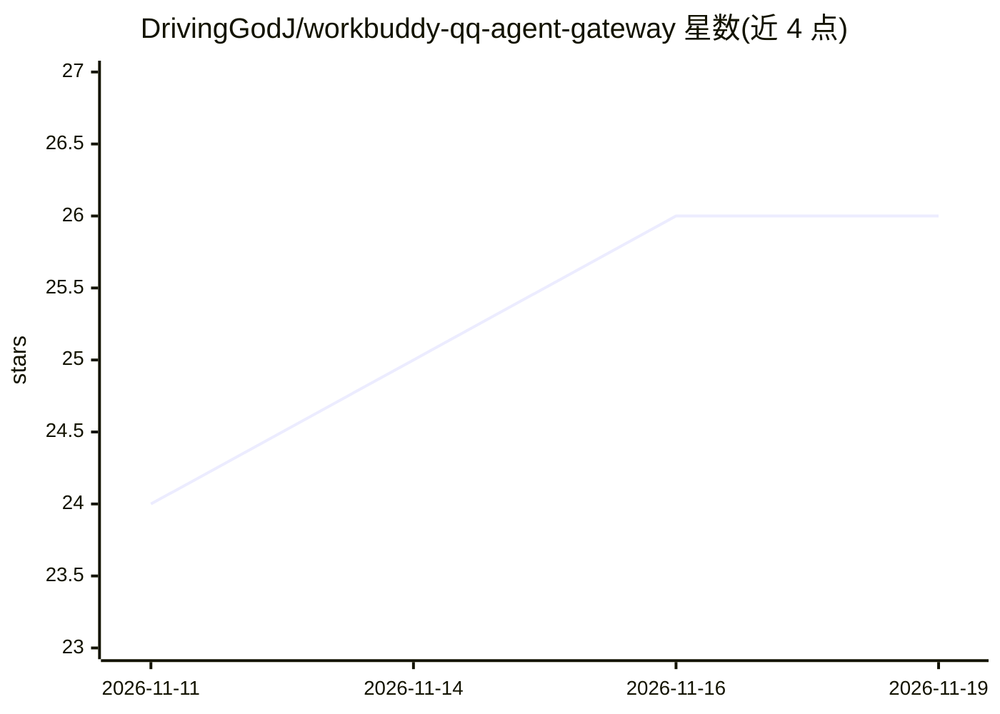

# DrivingGodJ/workbuddy-qq-agent-gateway

⭐ 26 · JavaScript · NOASSERTION · 推送 2026-11-08 · [GitHub](https://github.com/DrivingGodJ/workbuddy-qq-agent-gateway) · 个人维护 · 中文 README

**把本机 WorkBuddy Agent 接入 QQ 群聊/私聊的网关**

运行在本机的网关服务：将 WorkBuddy Agent 连入 QQ 的群聊与私聊，接收消息、文件与图片并代为发送回复、文件、图片与表情。每个会话持久保留，重启后可继续。配套网页面板展示实时输出、待处理消息与队列，可调整会话模型、推理与执行权限，支持暂停回复或中断任务。另提供通知订阅（按等待窗口汇总分发）、表情库管理，并可按独立授权接入 Home Assistant、Apple 日历/提醒、小爱播报与 QQ 空间。提供不登录 QQ、不调用模型的本地演示；真实部署面向 macOS，需自备 WorkBuddy 与 QQ 桥。基于 Epic0522/Codex-Remote-Contact 扩展，上游许可未声明。

## 筛选速览

| 维度 | 判定 | 备注 |
|---|---|---|
| AI 角色 | `ai-ecosystem` | LLM/agent 周边工具 |
| 许可风险 | `none` | NOASSERTION |
| 部署形态 | `None` |  |
| 模型依赖 | — | README 未给出锁定关系 |
| 硬件要求 | — | 无带数字的原话,不猜 |
| 安装摩擦 | `low` | 无编译、无系统依赖或容器化 |
| 成熟度 | — | 结构信号不足 |

## 能力要点

- 群聊/私聊持久会话，重启后继续，可跨私聊关联群上下文
- 网页面板查看实时输出、待处理消息与队列，可暂停/中断任务
- 按等待窗口汇总的目标通知订阅，避免无差别群发
- 可按独立授权接入 Home Assistant、Apple 日历/提醒、小爱播报等

## 适用场景

- 在 QQ 群里让本机 Agent 接任务并跟进消息、文件与工具操作
- 通过网页面板监控 Agent 实时进展并随时暂停或中断
- 把重要通知汇总后定向发给需要订阅的人

## 场景标签

`聊天机器人` · 领域:对话与助手

## 证据(README 行号)

> L5: 让本机 WorkBuddy Agent 进入 QQ 的日常对话：接住群聊和私聊里的任务，把消息、文件与工具操作连起来，在网页里看见它正在做什么。
> L15: 在面板查看实时输出、待处理消息和队列，调整会话模型与执行权限。想暂停回复或中断当前任务时，直接在界面操作，不必把控制命令混进群消息。
> L35: 项目提供不登录 QQ、不调用模型的本地演示，适合先看看面板与交互。真实部署面向 macOS，使用自己的 WorkBuddy 与 QQ 桥。

## 星数曲线

2026-11-11 24 → 2026-11-19 26（+2）

---
*卡片 v1 · prompt 1.4 · 生成 2026-11-18 · 置信度 high · 依据 README sha `450c4f4701f1` · [字段定义](../../DATASET.md)*
