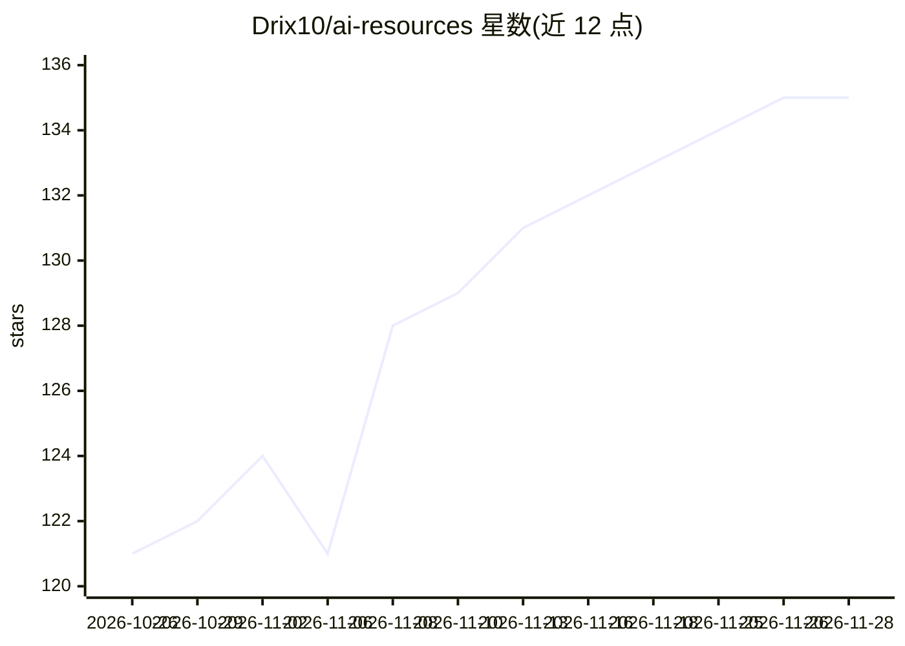

# Drix10/ai-resources

⭐ 135 · HTML · CC-BY-4.0 · 推送 2026-11-26 · [GitHub](https://github.com/Drix10/ai-resources) · [官网](https://blogs.drix10.com) · 个人维护

**10万+条 AI 资讯简报库，可经 MCP 供 agent 检索**

由自动化流水线从 41 个类别的人工挑选 X 列表生成简报，每条含标题、2-3 句事实与关键数字，并通过事实门校验（数字、版本须在原帖中出现），全部为 Markdown、CC BY 4.0 许可。面向工程师、创始人/投资人、研究者及构建 RAG/评测者，提供 MCP server（npm 包，MIT）、Agent Skill、JSON API、llms.txt/RSS 与 git clone 五种接入方式，均无需 key。Signals 页按计数方法追踪周环比上升的主题。作者自述旧档案部分简报缺少来源链接。

## 筛选速览

| 维度 | 判定 | 备注 |
|---|---|---|
| AI 角色 | `ai-knowledge` | 知识聚合/清单类 |
| 许可风险 | `viral` | CC-BY-4.0 |
| 部署形态 | `library` | 以包/库形式分发 |
| 模型依赖 | — | README 未给出锁定关系 |
| 硬件要求 | — | 无带数字的原话,不猜 |
| 安装摩擦 | `low` | 无编译、无系统依赖或容器化 |
| 成熟度 | — | 结构信号不足 |

## 能力要点

- 100,000+ 条简报经事实门校验并附来源链接
- MCP server、Agent Skill、JSON API、llms.txt/RSS 五种接入方式
- Signals 按周计数追踪覆盖上升主题（MOVEMENTS.md 公开）
- 自动化流水线生成，10,900+ commits

## 适用场景

- 为 RAG/评测构建带日期与来源的 AI 新闻语料
- 在 Claude Code/Cursor 中查询本周模型与工具动态
- 追踪融资、发布与基准数据的最新进展

## 场景标签

`模型评测` `RAG` `精选清单` · 领域:评测与运维

## 证据(README 行号)

> L13:  41 categories Models, dev tools, research and funding, plus robotics, climate, quantum, security and crypto.
> L35: 100,000+ dated, sourced briefings in plain Markdown for RAG, evals or an offline index. Every <code>resources-NNN.m
> L193: Nobody types these. A pipeline reads the hand-picked X lists for each category, writes one briefing per strong pos

## 星数曲线

2026-10-26 121 → 2026-11-28 135（+14）

---
*卡片 v1 · prompt 1.4 · 生成 2026-11-28 · 置信度 high · 依据 README sha `311e794510f1` · [字段定义](../../DATASET.md)*
