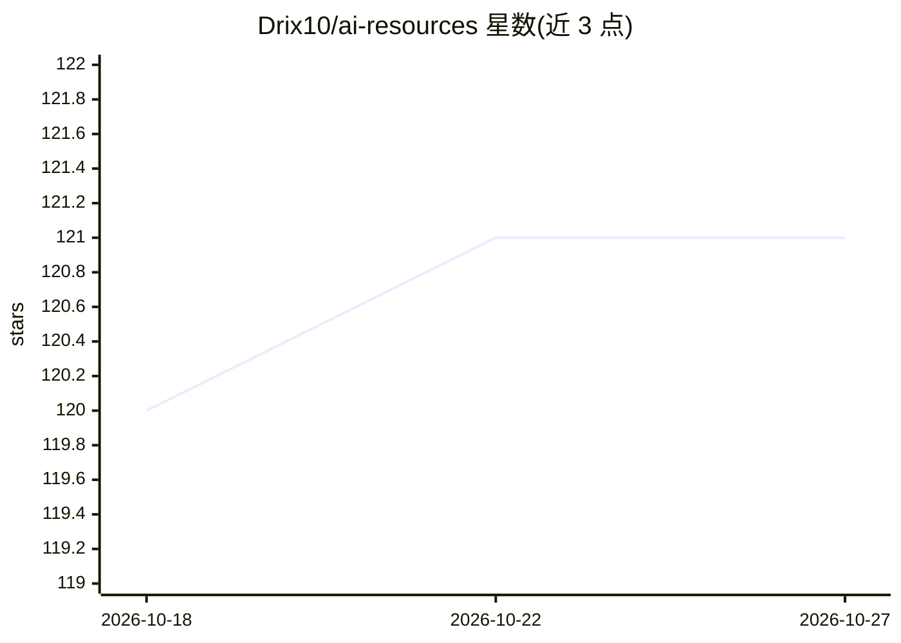

# Drix10/ai-resources

⭐ 121 · CC-BY-4.0 · 推送 2026-10-26 · [GitHub](https://github.com/Drix10/ai-resources) · [官网](https://blogs.drix10.com) · 个人维护

**AI 资讯策展知识库：41 类 10 万+条带来源摘要**

个人维护的 AI 资讯聚合仓库：由开源 ai-resources-pipeline 流水线读取各类别精选 X 列表，为每条强帖生成含标题、两三句摘要与关键数字的简报，校验数字与姓名后提交为 Markdown 摘要文件。内容覆盖 AI 开发者工具、VC、机器人、加密、AR/VR、气候科技等 41 类，共 10 万+条目，每条链接回原始帖。同步发布至 blogs.drix10.com 并支持搜索。已知限制：摘要由机器生成可能有误，2024 至 2026 年中部分旧存档无来源链接。使用方式为阅读、git clone 解析或 RSS 订阅。

## 筛选速览

| 维度 | 判定 | 备注 |
|---|---|---|
| AI 角色 | `ai-knowledge` | 知识聚合/清单类 |
| 许可风险 | `viral` | CC-BY-4.0 |
| 部署形态 | `None` |  |
| 模型依赖 | — | README 未给出锁定关系 |
| 硬件要求 | — | 无带数字的原话,不猜 |
| 安装摩擦 | `low` | 无编译、无系统依赖或容器化 |
| 成熟度 | — | 结构信号不足 |

## 能力要点

- 41 个类别、10 万+条目，每条链接回原始帖子
- 流水线自动生成摘要并做数字/姓名事实校验
- 纯 Markdown 公开仓库，可 clone、grep 或喂给自有工具
- 同步发布至 blogs.drix10.com，含搜索与主题页

## 适用场景

- 按领域快速跟进 AI 工具、模型与公司的动态
- 克隆仓库后用脚本解析 Markdown 做自定义分析
- 通过 RSS 或博客搜索查阅某个 AI 领域的近期摘要

## 场景标签

`精选清单` · 领域:学习与行业

## 证据(README 行号)

> L3:  Short, sourced briefings on AI tools, models, research, companies and the people building them.
> L24: - **Organized by who and what.** 41 categories, from AI Developer Tools and CS Academics to VC Firms, Quantum Compu
> L53: Digests are written by the open-source ai-resources-pipeline: it reads curated X lists per category, writes one sho

## 星数曲线

2026-10-18 120 → 2026-10-27 121（+1）

---
*卡片 v1 · prompt 1.4 · 生成 2026-10-23 · 置信度 high · 依据 README sha `b0a28b4df1b4` · [字段定义](../../DATASET.md)*
